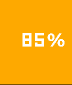
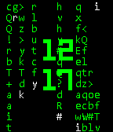

<!-- Generated by scripts/update_app_directory.py: do not edit by hand -->
[← All Pebble Developers](../developers.md)

# Marcelo Lazaroni

*2 watchfaces · Last updated 2026-10-12 · [About these lists](../about-app-lists.md)*

Links: [Pebble App Store](https://apps.repebble.com/apps/dev/marcelo-lazaroni_5565fcb808c37657f1000080) · [GitHub (lazaronijunior)](https://github.com/lazaronijunior)

<button type="button" data-filter="all" aria-pressed="true">All 2</button><button type="button" data-filter="watchface" aria-pressed="false">Watchfaces 2</button><button type="button" data-filter="watchapp" aria-pressed="false" disabled>Apps 0</button>

<label class="dev-sort">Sort by <select><option value="updated">Recently updated</option><option value="released">Newest release</option><option value="title">A–Z</option></select></label>

<h2 class="app-name" id="app-55ad34495ce176822500008c"><a href="https://apps.repebble.com/55ad34495ce176822500008c">Percentage</a> v1.0</h2>
<a class="app-source" href="https://github.com/lazaronijunior/Percentage-Watchface" title="Source code" data-search-exclude>View source</a>

Watchface

Released 2015-07-20 Updated 2015-07-22

Runs on: Time 2, Time

See the time in a different way. Seeing time as a percentage you can be more aware of how much of your time you are dedicating to each thing. The background colour changes from green to red as the…

<h2 class="app-name" id="app-55ad3d946749cded0f000098"><a href="https://apps.repebble.com/55ad3d946749cded0f000098">Matrix</a> v1.01</h2>
<a class="app-source" href="https://github.com/lazaronijunior/Matrix-Watchface" title="Source code" data-search-exclude>View source</a>

Watchface

Released 2015-07-20 Updated 2015-07-21

Runs on: Time 2, Pebble 2 Duo, Pebble 2, Time, Classic

Have the Matrix on your wrist. Every time you flick your wrist you will see matrix&#x27;s code rain on your watch. Aaaand it&#x27;s open source! You can learn from the code and create your own awesome…

