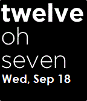

<!-- Generated by scripts/update_app_directory.py: do not edit by hand -->
[← All Pebble Developers](../developers.md)

# Marckus

*1 watchface · Last updated 2026-10-11 · [About these lists](../about-app-lists.md)*

Links: [Pebble App Store](https://apps.repebble.com/apps/dev/marckus_529a124ee627ceb7110000d0) · [GitHub (Marckus)](https://github.com/Marckus)

<h2 class="app-name" id="app-529a1981e627ce3b260000d1"><a href="https://apps.repebble.com/529a1981e627ce3b260000d1">Words + Date + Day (of the week) 2</a> v1.0.2</h2>
<a class="app-source" href="https://github.com/Marckus/Words_Date_Day2" title="Source code" data-search-exclude>View source</a>

Watchface

No licence Released 2013-11-30 Updated 2014-01-20

Runs on: Time 2, Pebble 2 Duo, Pebble 2, Time, Classic

Like Text Watch with animations and &#x27;oh&#x27;, the date, and day of the week in a smaller font at the bottom. This version has been updated to work with the 2.0 SDK. Based entirely off of…

