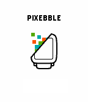

<!-- Generated by scripts/update_app_directory.py: do not edit by hand -->
[← All Pebble Developers](../developers.md)

# Marcteys

*1 app · Last updated 2026-10-12 · [About these lists](../about-app-lists.md)*

Links: [Pebble App Store](https://apps.repebble.com/apps/dev/marcteys_5515c4455ca749d2ce00001a) · [GitHub (marcteys)](https://github.com/marcteys) · [Website (half4.com)](http://half4.com/pixebble/)

<h2 class="app-name" id="app-56a63eaeed368bd240000035"><a href="https://apps.repebble.com/56a63eaeed368bd240000035">Pixebble</a> v1.2</h2>
<a class="app-source" href="https://github.com/marcteys/pixebble" title="Source code" data-search-exclude>View source</a>

App

Released 2016-01-25 Updated 2016-12-27

Runs on: Round 2, Time 2, Pebble 2 Duo, Pebble 2, Time Round, Time, Classic

Pixebble is the fastest way to preview your designs accurately on Pebble devices. With Pixebble, you can make sure your designs appear exactly the way you want on the Pebble OG, Pebble Time or…

