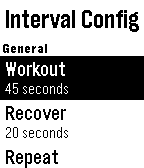

<!-- Generated by scripts/update_app_directory.py: do not edit by hand -->
[← All Pebble Developers](../developers.md)

# Marcus Gotling

*1 watchface and 1 app · Last updated 2026-10-12 · [About these lists](../about-app-lists.md)*

Links: [Pebble App Store](https://apps.repebble.com/apps/dev/marcus-gotling_52d1bfcb2fb6950b8200006c) · [GitHub (gotling)](https://github.com/gotling) · [GitHub (GotlingSystem)](https://github.com/GotlingSystem) · [Website (forums.pebble.com)](https://forums.pebble.com/t/watchapp-gosy-run-helps-you-exercise-running/25822)

<button type="button" data-filter="all" aria-pressed="true">All 2</button><button type="button" data-filter="watchface" aria-pressed="false">Watchfaces 1</button><button type="button" data-filter="watchapp" aria-pressed="false">Apps 1</button>

<label class="dev-sort">Sort by <select><option value="updated">Recently updated</option><option value="released">Newest release</option><option value="title">A–Z</option></select></label>

<h2 class="app-name" id="app-52dac915889f5d8253000261"><a href="https://apps.repebble.com/52dac915889f5d8253000261">GoSy Run</a> v1.7</h2>
<a class="app-source" href="https://github.com/gotling/GoSy-Run" title="Source code" data-search-exclude>View source</a>

App

No licence Released 2014-01-18 Updated 2016-11-15

Runs on: Time 2, Pebble 2 Duo, Pebble 2, Time, Classic

Helps you exercise running. - Interval timer with extended rest, warm up and cool down - Ladder timer - Stretch timer with 8 exercises

<h2 class="app-name" id="app-52e675f414a5c92ca2000032"><a href="https://apps.repebble.com/52e675f414a5c92ca2000032">Parabolic Eye</a> v1.1.0</h2>
<a class="app-source" href="https://github.com/GotlingSystem/Parabolic-Eye" title="Source code" data-search-exclude>View source</a>

Watchface

No licence Released 2014-01-27 Updated 2014-02-12

Runs on: Time 2, Pebble 2 Duo, Pebble 2, Time, Classic

Displays the time as an eye using lines to form parabolic curves and a circle. Time of screenshots 1: 04:30:30 2: 14:15:42 3: 20:45:16 Setting for inverse colors. Updates every second so most…

