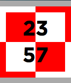

<!-- Generated by scripts/update_app_directory.py: do not edit by hand -->
[← All Pebble Developers](../developers.md)

# Marek Będkowski

*1 watchface · Last updated 2026-10-12 · [About these lists](../about-app-lists.md)*

Links: [Pebble App Store](https://apps.repebble.com/apps/dev/marek-b-dkowski_56e11726022c05e46c000048)

<h2 class="app-name" id="app-575f252ee1d0457e82000005"><a href="https://apps.repebble.com/575f252ee1d0457e82000005">Polish checkerboard PJSX</a> v1.1</h2>
<a class="app-source" href="https://pjsx.pl/checkerboard.html" title="Source code" data-search-exclude>View source</a>

Watchface

Released 2016-06-13 Updated 2016-06-20

Runs on: Round 2, Time 2, Time Round, Time

This watchface is based on polish heraldic symbol - checkerboard. It&#x27;s present on Polish air vessels: https://pjsx.pl/checkerboard.html

