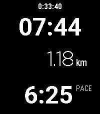

<!-- Generated by scripts/update_app_directory.py: do not edit by hand -->
[← All Pebble Developers](../developers.md)

# Marian Kleineberg

*1 watchface and 1 app · Last updated 2026-10-11 · [About these lists](../about-app-lists.md)*

Links: [Pebble App Store](https://apps.repebble.com/apps/dev/marian-kleineberg_baf010dd9e5a56929a4b069a) · [GitHub (marian42)](https://github.com/marian42)

<button type="button" data-filter="all" aria-pressed="true">All 2</button><button type="button" data-filter="watchface" aria-pressed="false">Watchfaces 1</button><button type="button" data-filter="watchapp" aria-pressed="false">Apps 1</button>

<label class="dev-sort">Sort by <select><option value="updated">Recently updated</option><option value="released">Newest release</option><option value="title">A–Z</option></select></label>

<h2 class="app-name" id="app-52f1fa11b9d04556a636bb3c"><a href="https://apps.repebble.com/52f1fa11b9d04556a636bb3c">Run Tracker</a> v1.0</h2>
<a class="app-source" href="https://github.com/marian42/pebble-run-tracker" title="Source code" data-search-exclude>View source</a>

App

Released 2026-04-12 Updated 2026-04-12

Runs on: Round 2, Time 2, Pebble 2 Duo, Pebble 2, Time Round, Time, Classic

This is a run / walk tracker for Pebble with a focus on simplicity. It doesn&#x27;t require a companion app but it does require a connection to a phone for GPS. The app shows the time, distance and…

<h2 class="app-name" id="app-06e7836c4f704cf5bd8c987f"><a href="https://apps.repebble.com/06e7836c4f704cf5bd8c987f">London Underground Clock</a> v1.0.1</h2>
<a class="app-source" href="https://github.com/marian42/pebble-london-clock" title="Source code" data-search-exclude>View source</a>

Watchface

Released 2026-04-08 Updated 2026-04-09

Runs on: Round 2, Time 2, Pebble 2 Duo, Pebble 2, Time Round, Time, Classic

Inspired by a design of LCD clocks that can be found on some London Underground stations. The same design is also one of the available clocks in Nothing OS.

