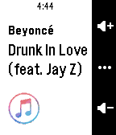

<!-- Generated by scripts/update_app_directory.py: do not edit by hand -->
[← All Pebble Developers](../developers.md)

# Mario Cecchi

*1 app · Last updated 2026-10-12 · [About these lists](../about-app-lists.md)*

Links: [Pebble App Store](https://apps.repebble.com/apps/dev/mario-cecchi_52f135477435d3a17f0001a4) · [GitHub (macecchi)](https://github.com/macecchi)

<h2 class="app-name" id="app-55b5bdfe5e07169f58000022"><a href="https://apps.repebble.com/55b5bdfe5e07169f58000022">iTunesify Remote</a> v1.5</h2>
<a class="app-source" href="https://github.com/macecchi/pebble-itunesify-remote" title="Source code" data-search-exclude>View source</a>

App

Released 2015-07-27 Updated 2016-07-07

Runs on: Round 2, Time 2, Pebble 2 Duo, Pebble 2, Time Round, Time, Classic

Control iTunes and Spotify on your Mac using your Pebble, just like the Music app! You&#x27;ll need to run &#x27;iTunesify Remote for Pebble&#x27; on your Mac. On your Mac, go to bit.ly/pebble-itunes-mac and…

