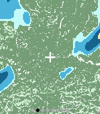
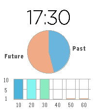

<!-- Generated by scripts/update_app_directory.py: do not edit by hand -->
[← All Pebble Developers](../developers.md)

# Mark Brackenborough

*1 watchface and 1 app · Last updated 2026-10-11 · [About these lists](../about-app-lists.md)*

Links: [Pebble App Store](https://apps.repebble.com/apps/dev/mark-brackenborough_ce59705c6fa3e86a17db5e3e) · [GitHub (MarkBrack)](https://github.com/MarkBrack) · [Website (x.com)](https://x.com/markbrack)

<button type="button" data-filter="all" aria-pressed="true">All 2</button><button type="button" data-filter="watchface" aria-pressed="false">Watchfaces 1</button><button type="button" data-filter="watchapp" aria-pressed="false">Apps 1</button>

<label class="dev-sort">Sort by <select><option value="updated">Recently updated</option><option value="released">Newest release</option><option value="title">A–Z</option></select></label>

<h2 class="app-name" id="app-f8d809ec478d4dd9a8af1450"><a href="https://apps.repebble.com/f8d809ec478d4dd9a8af1450">Rain Radar</a> v4.5.0</h2>
<a class="app-source" href="https://github.com/MarkBrack/pebble-weather-radar" title="Source code" data-search-exclude>View source</a>

App

No licence Released 2026-04-12 Updated 2026-09-19

Runs on: Time 2

See rain heading your way, right from your wrist. Rain Radar combines animated rain radar with a clear street map centred on your location, helping you judge where the rain is and whether it’s…

<h2 class="app-name" id="app-97eff38ceaf24f2b87d69719"><a href="https://apps.repebble.com/97eff38ceaf24f2b87d69719">Chart Clock</a> v1.0.0</h2>
<a class="app-source" href="https://github.com/MarkBrack/pebble-chart-watchface" title="Source code" data-search-exclude>View source</a>

Watchface

No licence Released 2026-04-03 Updated 2026-04-03

Runs on: Time 2

A pastel pebble time 2 watch face with pie and bar chart time visualisations, designed for data viz geeks.

