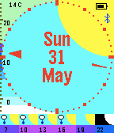
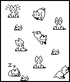

<!-- Generated by scripts/update_app_directory.py: do not edit by hand -->
[← All Pebble Developers](../developers.md)

# Mark Bush

*1 watchface and 1 app · Last updated 2026-10-11 · [About these lists](../about-app-lists.md)*

Links: [Pebble App Store](https://apps.repebble.com/apps/dev/mark-bush_52f2b53327122e3ad3000090) · [GitHub (markbush)](https://github.com/markbush)

<button type="button" data-filter="all" aria-pressed="true">All 2</button><button type="button" data-filter="watchface" aria-pressed="false">Watchfaces 1</button><button type="button" data-filter="watchapp" aria-pressed="false">Apps 1</button>

<label class="dev-sort">Sort by <select><option value="updated">Recently updated</option><option value="released">Newest release</option><option value="title">A–Z</option></select></label>

<h2 class="app-name" id="app-550f3186e0b81d4f1a000044"><a href="https://apps.repebble.com/550f3186e0b81d4f1a000044">Weather Watch</a> v3.2</h2>
<a class="app-source" href="https://github.com/markbush/weather-watch" title="Source code" data-search-exclude>View source</a>

Watchface

Released 2015-03-22 Updated 2015-10-31

Runs on: Time 2, Pebble 2 Duo, Pebble 2, Time, Classic

Simple watchface with date and weather info. The hands are discreet on the outside so don&#x27;t obscure the information being displayed. Options are available for temperature units, whether to show…

<h2 class="app-name" id="app-5579cfbfc8061af31f000051"><a href="https://apps.repebble.com/5579cfbfc8061af31f000051">Neko</a> v1.0</h2>
<a class="app-source" href="https://github.com/markbush/pebble-neko" title="Source code" data-search-exclude>View source</a>

App

Released 2015-06-11 Updated 2015-06-13

Runs on: Time 2, Pebble 2 Duo, Pebble 2, Time, Classic

Neko, that lovable rascal, is back, and this time, she&#x27;s on your wrist! Tilt the watch to move the mouse and Neko will chase after it. When she catches it, she gets bored and falls asleep. If the…

