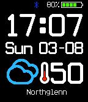

<!-- Generated by scripts/update_app_directory.py: do not edit by hand -->
[← All Pebble Developers](../developers.md)

# Markas\_K

*2 watchfaces · Last updated 2026-10-11 · [About these lists](../about-app-lists.md)*

Links: [Pebble App Store](https://apps.repebble.com/apps/dev/markas-k_53920770b2e95859f8000032) · [GitHub (marasm)](https://github.com/marasm)

<button type="button" data-filter="all" aria-pressed="true">All 2</button><button type="button" data-filter="watchface" aria-pressed="false">Watchfaces 2</button><button type="button" data-filter="watchapp" aria-pressed="false" disabled>Apps 0</button>

<label class="dev-sort">Sort by <select><option value="updated">Recently updated</option><option value="released">Newest release</option><option value="title">A–Z</option></select></label>

<h2 class="app-name" id="app-53d6b06c0433442454000172"><a href="https://apps.repebble.com/53d6b06c0433442454000172">GeekyTime</a> v4.0</h2>
<a class="app-source" href="https://github.com/marasm/GeekyTime" title="Source code" data-search-exclude>View source</a>

Watchface

Released 2014-07-28 Updated 2016-07-31

Runs on: Time 2, Pebble 2 Duo, Pebble 2, Time, Classic

A simple watch face showing all the essential information for a busy Pebbler. Included: -Time (12 or 24 hour format) -Current weather conditions for the location (Celcius or Fahrenheit) -Bluetooth…

<h2 class="app-name" id="app-5511c304c496d8aa9f00002c"><a href="https://apps.repebble.com/5511c304c496d8aa9f00002c">BigDotz</a> v1.4</h2>
<a class="app-source" href="https://github.com/marasm/GeekyTime" title="Source code" data-search-exclude>View source</a>

Watchface

Released 2015-03-24 Updated 2016-06-09

Runs on: Time 2, Pebble 2 Duo, Pebble 2, Time, Classic

A simple watchface using square dots to form the digits. Features: - Animated - 12/24 Hr Support (Set in pebble settings) - Date with Day of the Week - Battery Indicator - Vibrate on phone…

