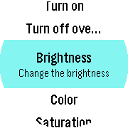

<!-- Generated by scripts/update_app_directory.py: do not edit by hand -->
[← All Pebble Developers](../developers.md)

# Markus Gutbrod

*1 app · Last updated 2026-10-12 · [About these lists](../about-app-lists.md)*

Links: [Pebble App Store](https://apps.repebble.com/apps/dev/markus-gutbrod_56a684837a473973dc000060) · [GitHub (bigbug)](https://github.com/bigbug)

<h2 class="app-name" id="app-56b5f4147d6b52077500001b"><a href="https://apps.repebble.com/56b5f4147d6b52077500001b">LIFX</a> v0.98</h2>
<a class="app-source" href="https://github.com/bigbug/LIFX4Pebble" title="Source code" data-search-exclude>View source</a>

App

No licence Released 2016-02-06 Updated 2016-02-24

Runs on: Round 2, Time Round

With this app you can control your LIFX bulb(s). Currently supported features: - turn your bulb on and off - change the color, brightness and saturation - Experimental: set an alarm. Before the…

