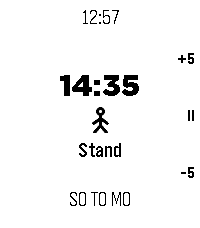

<!-- Generated by scripts/update_app_directory.py: do not edit by hand -->
[← All Pebble Developers](../developers.md)

# Markus Wessjohann

*1 app · Last updated 2026-11-09 · [About these lists](../about-app-lists.md)*

Links: [Pebble App Store](https://apps.repebble.com/apps/dev/markus-wessjohann_86e420188f988f626f6add41) · [GitHub (MarkusWessjohann)](https://github.com/MarkusWessjohann)

<h2 class="app-name" id="app-a81a67f4078d4579949260b0"><a href="https://apps.repebble.com/a81a67f4078d4579949260b0">Sit Stand Move</a> v1.0.5</h2>
<a class="app-source" href="https://github.com/MarkusWessjohann/Pebble_Sit_Stand_Move" title="Source code" data-search-exclude>View source</a>

App · <a href="https://forum.rebble.io/t/1487" title="Discuss this app on the Rebble forum" data-search-exclude>Forum thread</a>

MIT Released 2026-11-04 Updated 2026-11-07

Runs on: Round 2, Time 2, Pebble 2 Duo, Pebble 2, Time Round, Time, Classic

Reminder to Sit 45 minutes, stand 10 minutes and move 5 minutes.

