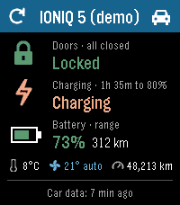
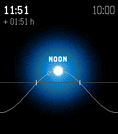
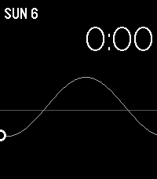

<!-- Generated by scripts/update_app_directory.py: do not edit by hand -->
[← All Pebble Developers](../developers.md)

# Marrrrtthias

*1 watchface and 2 apps · Last updated 2026-11-16 · [About these lists](../about-app-lists.md)*

Links: [Pebble App Store](https://apps.repebble.com/apps/dev/marrrrtthias_0737fb75312a8b5268569fec) · [GitHub (Marrrrtthias)](https://github.com/Marrrrtthias)

<button type="button" data-filter="all" aria-pressed="true">All 3</button><button type="button" data-filter="watchface" aria-pressed="false">Watchfaces 1</button><button type="button" data-filter="watchapp" aria-pressed="false">Apps 2</button>

<label class="dev-sort">Sort by <select><option value="updated">Recently updated</option><option value="released">Newest release</option><option value="title">A–Z</option></select></label>

<h2 class="app-name" id="app-32c7c20b0c4b471296fe70eb"><a href="https://apps.repebble.com/32c7c20b0c4b471296fe70eb">CarGlance for Hyundai, Kia, Genesis</a> v2.0.0</h2>
<a class="app-source" href="https://github.com/Marrrrtthias/CarGlance-pebble" title="Source code" data-search-exclude>View source</a>

App

GPL-3.0 Released 2026-11-03 Updated 2026-11-15

Runs on: Time 2

A Pebble watchapp that shows the status of your Hyundai, Kia or Genesis car at a glance: whether the doors are locked, whether it is charging, and the battery level. Data comes from the Pleos…

<h2 class="app-name" id="app-39857a1cdd1d42aa9313294f"><a href="https://apps.repebble.com/39857a1cdd1d42aa9313294f">Solar Times</a> v1.1.0</h2>
<a class="app-source" href="https://github.com/Marrrrtthias/pebble-solar-watchface" title="Source code" data-search-exclude>View source</a>

App

No licence Released 2026-11-13 Updated 2026-11-13

Runs on: Time 2

The interactive companion app to the Solar watchface for Pebble Time 2 (emery). It shows the same sun path for your location and lets you move the sun to today&#x27;s sunrise, solar noon and sunset…

<h2 class="app-name" id="app-959e38bf7c0d48ad92d4cdba"><a href="https://apps.repebble.com/959e38bf7c0d48ad92d4cdba">Solar</a> v1.1.0</h2>
<a class="app-source" href="https://github.com/Marrrrtthias/pebble-solar-watchface" title="Source code" data-search-exclude>View source</a>

Watchface

No licence Released 2026-11-10 Updated 2026-11-13

Runs on: Time 2

A Pebble Time 2 (emery) watchface inspired by the Apple Watch Solar face. It plots the sun&#x27;s elevation over the day for your location and shows a glowing sun at the current time. - The curve runs…

