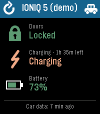

<!-- Generated by scripts/update_app_directory.py: do not edit by hand -->
[← All Pebble Developers](../developers.md)

# Marrrrtthias

*1 app · Last updated 2026-11-09 · [About these lists](../about-app-lists.md)*

Links: [Pebble App Store](https://apps.repebble.com/apps/dev/marrrrtthias_0737fb75312a8b5268569fec) · [GitHub (Marrrrtthias)](https://github.com/Marrrrtthias)

<h2 class="app-name" id="app-32c7c20b0c4b471296fe70eb"><a href="https://apps.repebble.com/32c7c20b0c4b471296fe70eb">CarGlance for Hyundai, Kia, Genesis</a> v1.1.0</h2>
<a class="app-source" href="https://github.com/Marrrrtthias/CarGlance-pebble" title="Source code" data-search-exclude>View source</a>

App

GPL-3.0 Released 2026-11-03 Updated 2026-11-08

Runs on: Time 2

A Pebble watchapp that shows the status of your Hyundai, Kia or Genesis car at a glance: whether the doors are locked, whether it is charging, and the battery level. Data comes from the Pleos…

