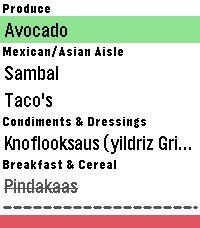

<!-- Generated by scripts/update_app_directory.py: do not edit by hand -->
[← All Pebble Developers](../developers.md)

# Marshal

*1 app · Last updated 2026-10-12 · [About these lists](../about-app-lists.md)*

Links: [Pebble App Store](https://apps.repebble.com/apps/dev/marshal_10cf95530af51400018175cb) · [GitHub (Velzeboer)](https://github.com/Velzeboer)

<h2 class="app-name" id="app-ff64d2aeab204b2ba3645c8a"><a href="https://apps.repebble.com/ff64d2aeab204b2ba3645c8a">The Every Shopping list app</a> v1.3.0</h2>
<a class="app-source" href="https://github.com/Velzeboer/pebble-every-list-shopping" title="Source code" data-search-exclude>View source</a>

App

No licence Released 2026-06-18 Updated 2026-09-21

Runs on: Round 2, Time 2, Pebble 2 Duo, Pebble 2, Time Round, Time, Classic

Have your shopping list right on your wrist! Just log in with your credentials on the settings page and you&#x27;re good to go. Features: - Check off items - Re-fetches latest data from your list on…

