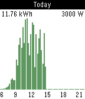

<!-- Generated by scripts/update_app_directory.py: do not edit by hand -->
[← All Pebble Developers](../developers.md)

# Martijn02

*1 app · Last updated 2026-10-11 · [About these lists](../about-app-lists.md)*

Links: [Pebble App Store](https://apps.repebble.com/apps/dev/martijn02_54f02d3c380aa60797000047) · [GitHub (Martijn02)](https://github.com/Martijn02)

<h2 class="app-name" id="app-5581703b7e7934d33a00000d"><a href="https://apps.repebble.com/5581703b7e7934d33a00000d">SolarEdge Status</a> v1.2</h2>
<a class="app-source" href="https://github.com/Martijn02/pebble-solaredge-status/" title="Source code" data-search-exclude>View source</a>

App

No licence Released 2015-06-17 Updated 2015-06-24

Runs on: Time 2, Pebble 2 Duo, Pebble 2, Time, Classic

Keep track of your solar energy production from your Pebble. Contains a view with detailed information, and a graph displaying your generated power per 15 minutes. Works with SolarEdge inverters…

