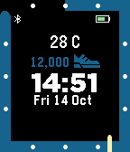

<!-- Generated by scripts/update_app_directory.py: do not edit by hand -->
[← All Pebble Developers](../developers.md)

# Martin

*1 watchface · Last updated 2026-10-12 · [About these lists](../about-app-lists.md)*

Links: [Pebble App Store](https://apps.repebble.com/apps/dev/martin_54e527230dc7cb506a000010) · [GitLab (mestorlx)](https://gitlab.com/mestorlx)

<h2 class="app-name" id="app-5778377466202aab020001d4"><a href="https://apps.repebble.com/5778377466202aab020001d4">Stride++</a> v1.3</h2>
<a class="app-source" href="https://gitlab.com/mestorlx/stridepp" title="Source code" data-search-exclude>View source</a>

Watchface

Released 2016-07-02 Updated 2016-10-14

Runs on: Round 2, Time 2, Pebble 2 Duo, Pebble 2, Time Round, Time, Classic

A digital watchface featuring Pebble Health activity data. Follow the progress of your step count on the outer ring. Cross the line when you&#x27;ve passed your current daily goal count. See your…

