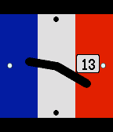

<!-- Generated by scripts/update_app_directory.py: do not edit by hand -->
[← All Pebble Developers](../developers.md)

# Martin Simoneau

*1 watchface · Last updated 2026-10-12 · [About these lists](../about-app-lists.md)*

Links: [Pebble App Store](https://apps.repebble.com/apps/dev/martin-simoneau_564f055471fb6163e200003a) · [GitHub (msimoneau)](https://github.com/msimoneau) · [Website (msimoneau.github.io)](http://msimoneau.github.io/watch-project/index.html)

<h2 class="app-name" id="app-567f2cec4c02107532000131"><a href="https://apps.repebble.com/567f2cec4c02107532000131">Paris</a> v1.01</h2>
<a class="app-source" href="https://github.com/msimoneau/paris" title="Source code" data-search-exclude>View source</a>

Watchface

Released 2015-12-27 Updated 2025-11-25

Runs on: Round 2, Time 2, Pebble 2 Duo, Pebble 2, Time Round, Time, Classic

Remembering Paris 2015.

