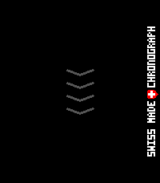
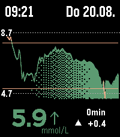
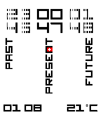
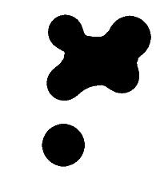

<!-- Generated by scripts/update_app_directory.py: do not edit by hand -->
[← All Pebble Developers](../developers.md)

# marukitano

*5 watchfaces and 2 apps · Last updated 2026-10-11 · [About these lists](../about-app-lists.md)*

Links: [Pebble App Store](https://apps.repebble.com/apps/dev/marukitano_ff2831479c1011a82df1985d) · [GitHub (marukitano)](https://github.com/marukitano)

<button type="button" data-filter="all" aria-pressed="true">All 7</button><button type="button" data-filter="watchface" aria-pressed="false">Watchfaces 5</button><button type="button" data-filter="watchapp" aria-pressed="false">Apps 2</button>

<label class="dev-sort">Sort by <select><option value="updated">Recently updated</option><option value="released">Newest release</option><option value="title">A–Z</option></select></label>

<h2 class="app-name" id="app-eccd3b6ffdd2436cbe643201"><a href="https://apps.repebble.com/eccd3b6ffdd2436cbe643201">Nasu</a> v1.1.5</h2>
<a class="app-source" href="https://github.com/marukitano/Nasu" title="Source code" data-search-exclude>View source</a>

App

Released 2026-08-15 Updated 2026-10-02

Runs on: Time 2

Deutsch Nasu ist eine Medikamenten-Erinnerungs-App für die Pebble Time 2 – mit einer kleinen Krankenschwester, die dich auf ihrer Vespa begleitet und daran erinnert, deine Medikamente zu nehmen…

<h2 class="app-name" id="app-24973dcf491d46fd90e166e1"><a href="https://apps.repebble.com/24973dcf491d46fd90e166e1">Swiss Chronograph</a> v1.0.2</h2>
<a class="app-source" href="https://github.com/marukitano/Swiss-Chronograph" title="Source code" data-search-exclude>View source</a>

App

Released 2026-08-03 Updated 2026-09-01

Runs on: Time 2

English One swipe. That’s it. Are you tired of timer apps where your finger covers exactly what you are trying to set? Or of tapping through menus again and again just to start a simple countdown?…

<h2 class="app-name" id="app-02a27e35c0a9494a9208e70f"><a href="https://apps.repebble.com/02a27e35c0a9494a9208e70f">OpenLibreLinkUp</a> v1.3.5</h2>
<a class="app-source" href="https://github.com/marukitano/OpenLibreLinkUp" title="Source code" data-search-exclude>View source</a>

Watchface

Released 2026-07-26 Updated 2026-08-20

Runs on: Time 2

English OpenLibreLinkUp is a glucose-monitoring watchface for the Pebble Time 2. It displays current FreeStyle Libre readings through the unofficial LibreLinkUp API, including glucose value, trend…

<h2 class="app-name" id="app-fa33ca96a9e1480890a251c2"><a href="https://apps.repebble.com/fa33ca96a9e1480890a251c2">Past-Present-Future</a> v1.0.2</h2>
<a class="app-source" href="https://github.com/marukitano/past-present-future" title="Source code" data-search-exclude>View source</a>

Watchface

Released 2026-07-31 Updated 2026-08-02

Runs on: Time 2

English The original design was created by Chris Lewis. With his permission, I adapted and rebuilt it for the new Pebble Time 2, added new animations, themes, weather, configuration options and a…

<h2 class="app-name" id="app-fafbbd65c0a14e07b37c71ea"><a href="https://apps.repebble.com/fafbbd65c0a14e07b37c71ea">Lavalamp</a> v1.2.1</h2>
<a class="app-source" href="https://github.com/marukitano/Lavalamp" title="Source code" data-search-exclude>View source</a>

Watchface

Released 2026-07-24 Updated 2026-07-29

Runs on: Time 2, Pebble 2 Duo, Pebble 2, Time, Classic

English Lavalamp is a binary watchface that displays the current time using animated, organic blobs. The upper blobs represent the hours, while the lower blobs represent the minutes. Each position…

<h2 class="app-name" id="app-1964d553c3b347d99040ca2a"><a href="https://apps.repebble.com/1964d553c3b347d99040ca2a">Hidden in Perspective</a> v1.1.0</h2>
<a class="app-source" href="https://github.com/marukitano/Hidden_in_Perspective" title="Source code" data-search-exclude>View source</a>

Watchface

Released 2026-07-29 Updated 2026-07-29

Runs on: Time 2

Deutsch Perspective verwandelt deine Pebble Time 2 in ein kleines 3D-Display am Handgelenk. Die Uhrzeit besteht aus einer schwebenden Punktwolke, die sich mithilfe des Beschleunigungssensors…

<h2 class="app-name" id="app-ee9868f8875f4d2c81ebac42"><a href="https://apps.repebble.com/ee9868f8875f4d2c81ebac42">FCK_Gravity</a> v1.2.0</h2>
<a class="app-source" href="https://github.com/marukitano/FCK_Gravity" title="Source code" data-search-exclude>View source</a>

Watchface

Released 2026-07-26 Updated 2026-07-29

Runs on: Time 2

##Deutsch ### Kurzbeschreibung Ein schwerkraftgesteuertes Vektor-Ziffernblatt für die Pebble Time 2. ### Beschreibung Gravity ist ein minimalistisches, schwerkraftgesteuertes Ziffernblatt für die…

