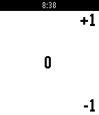
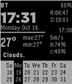
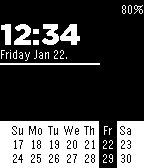

<!-- Generated by scripts/update_app_directory.py: do not edit by hand -->
[← All Pebble Developers](../developers.md)

# masmddr

*2 watchfaces and 1 app · Last updated 2026-10-11 · [About these lists](../about-app-lists.md)*

Links: [Pebble App Store](https://apps.repebble.com/apps/dev/masmddr_54323d5d4a9ca48ba80000d5) · [GitHub (sheydenis)](https://github.com/sheydenis)

<button type="button" data-filter="all" aria-pressed="true">All 3</button><button type="button" data-filter="watchface" aria-pressed="false">Watchfaces 2</button><button type="button" data-filter="watchapp" aria-pressed="false">Apps 1</button>

<label class="dev-sort">Sort by <select><option value="updated">Recently updated</option><option value="released">Newest release</option><option value="title">A–Z</option></select></label>

<h2 class="app-name" id="app-57b309a2f01b53ce0c000591"><a href="https://apps.repebble.com/57b309a2f01b53ce0c000591">SimpleCounter</a> v1.11</h2>
<a class="app-source" href="https://github.com/sheydenis/SimpleCounter" title="Source code" data-search-exclude>View source</a>

App

Released 2016-08-16 Updated 2016-09-28

Runs on: Time 2, Pebble 2 Duo, Pebble 2, Time, Classic

A simple counter app. Saves count on exit, no vibrations, no fancy colors. Comma separated digits by groups of 3. (Free Pro feature) Up / down buttons for +1 / -1 . Long press down to reset count…

<h2 class="app-name" id="app-56250097851cda8fa100005e"><a href="https://apps.repebble.com/56250097851cda8fa100005e">YAWWc</a> v1.4</h2>
<a class="app-source" href="https://github.com/sheydenis/YAWWv1" title="Source code" data-search-exclude>View source</a>

Watchface

Released 2015-10-19 Updated 2016-06-24

Runs on: Time 2, Pebble 2 Duo, Pebble 2, Time, Classic

Yet another weather watchface (Celsius). Shows time and weather information such as: Sunrise and sunset times at the top right (R: and S: respectively). Wind speed, humidity and cloudiness at the…

<h2 class="app-name" id="app-569fd665a1ebd0d42c000064"><a href="https://apps.repebble.com/569fd665a1ebd0d42c000064">SimpleCal</a> v1.22</h2>
<a class="app-source" href="https://github.com/sheydenis/SimpleCal" title="Source code" data-search-exclude>View source</a>

Watchface

Released 2016-01-20 Updated 2016-03-05

Runs on: Time 2, Pebble 2 Duo, Pebble 2, Time, Classic

A simple watchface with a calendar and battery charge indicator. Also features a bar on the right to indicate seconds. (0,10,20,30,40,50 seconds)

