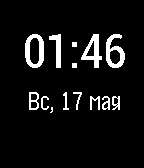

<!-- Generated by scripts/update_app_directory.py: do not edit by hand -->
[← All Pebble Developers](../developers.md)

# Master\_Groosha

*1 watchface · Last updated 2026-10-12 · [About these lists](../about-app-lists.md)*

Links: [Pebble App Store](https://apps.repebble.com/apps/dev/master-groosha_548041afa5302c2ce400001e) · [GitHub (Kondra007)](https://github.com/Kondra007) · [Website (pebble.groosh.pw)](http://pebble.groosh.pw)

<h2 class="app-name" id="app-5484b0a7479e157ea00000e3"><a href="https://apps.repebble.com/5484b0a7479e157ea00000e3">Simple Russian Watchface</a> v1.3</h2>
<a class="app-source" href="https://github.com/Kondra007/PebbleWatchfaceCondensed" title="Source code" data-search-exclude>View source</a>

Watchface

No licence Released 2014-12-07 Updated 2016-11-23

Runs on: Time 2, Pebble 2 Duo, Pebble 2, Time, Classic

Simple watchface for Russian users ---------- Простенькие часы для русскоговорящих пользователей. Только время и дата, ничего лишнего.

