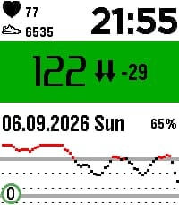

<!-- Generated by scripts/update_app_directory.py: do not edit by hand -->
[← All Pebble Developers](../developers.md)

# Masterplexus

*1 watchface · Last updated 2026-10-12 · [About these lists](../about-app-lists.md)*

Links: [Pebble App Store](https://apps.repebble.com/apps/dev/masterplexus_20a20291203795e69e04dc1a) · [GitHub (MasterPlexus)](https://github.com/MasterPlexus)

<h2 class="app-name" id="app-e53dd73e9ead4df297762948"><a href="https://apps.repebble.com/e53dd73e9ead4df297762948">Master-Plexus-CGM-NG</a> v0.3.0</h2>
<a class="app-source" href="https://github.com/MasterPlexus/masterplexus-cgm-ng" title="Source code" data-search-exclude>View source</a>

Watchface

MIT Released 2026-09-06 Updated 2026-09-19

Runs on: Time 2, Pebble 2 Duo, Pebble 2, Time, Classic

initial. Tested on Pebble time two. Basis from urchin-cgm, all honors to him. Anyhow to know: this Watchface is made for having Blood measurements visible from Nightscout and Dexcom. Improved cgm…

