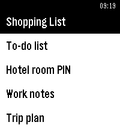

<!-- Generated by scripts/update_app_directory.py: do not edit by hand -->
[← All Pebble Developers](../developers.md)

# matejdro

*4 apps · Last updated 2026-10-11 · [About these lists](../about-app-lists.md)*

Links: [Rebble App Store](https://apps.rebble.io/en_US/developer/52b1ea273beaa0cecb00001f/1) · [Pebble App Store](https://apps.repebble.com/apps/dev/matejdro_52b1ea273beaa0cecb00001f) · [GitHub (matejdro)](https://github.com/matejdro)

<button type="button" data-filter="all" aria-pressed="true">All 4</button><button type="button" data-filter="watchface" aria-pressed="false" disabled>Watchfaces 0</button><button type="button" data-filter="watchapp" aria-pressed="false">Apps 4</button>

<label class="dev-sort">Sort by <select><option value="updated">Recently updated</option><option value="released">Newest release</option><option value="title">A–Z</option></select></label>

<h2 class="app-name" id="app-69c000c26d8fa50009bffa61"><a href="https://apps.rebble.io/en_US/application/69c000c26d8fa50009bffa61">Notification Center</a> v2.10</h2>
<a class="app-source" href="https://github.com/matejdro/PebbleNotificationCenter2" title="Source code" data-search-exclude>View source</a>

App · <a href="https://forum.rebble.io/t/788" title="Discuss this app on the Rebble forum" data-search-exclude>Forum thread</a>

Released 2026-03-22 Updated 2026-09-16 Rebble App Store

Runs on: Time 2, Pebble 2 Duo, Pebble 2, Time

A complete replacement app for Pebble notifications with more features and wider customisation. Click &quot;Website Link&quot; below for more information. (Thanks to the LCP for the help with the banner)

<h2 class="app-name" id="app-6a3cc9bccd52370009f40d2d"><a href="https://apps.rebble.io/en_US/application/6a3cc9bccd52370009f40d2d">Text Sync</a> v1.1</h2>
<a class="app-source" href="https://github.com/matejdro/PebbleTextSync" title="Source code" data-search-exclude>View source</a>

App · <a href="https://forum.rebble.io/t/1083" title="Discuss this app on the Rebble forum" data-search-exclude>Forum thread</a>

Released 2026-06-25 Updated 2026-08-02 Rebble App Store

Runs on: Time 2, Pebble 2 Duo, Pebble 2, Time

Show your text/markdown files on the watch. Click &quot;Website Link&quot; below for more information.

<h2 class="app-name" id="app-69501540da1501000944b086"><a href="https://apps.rebble.io/en_US/application/69501540da1501000944b086">Catapult</a> v0.90</h2>
<a class="app-source" href="https://github.com/matejdro/PebbleCatapult" title="Source code" data-search-exclude>View source</a>

App · <a href="https://forum.rebble.io/t/310" title="Discuss this app on the Rebble forum" data-search-exclude>Forum thread</a>

Released 2025-12-27 Updated 2026-06-25 Rebble App Store

Runs on: Time 2, Pebble 2 Duo, Pebble 2, Time

Launch Tasker tasks from your watch Android companion app is needed. It allows users to define a list of tasks that then show up on a watch and can be remotely activated. Tasks can also be put…

<h2 class="app-name" id="app-532323bf60c773c1420000a8"><a href="https://apps.repebble.com/532323bf60c773c1420000a8">Dialer for Pebble</a> v3.3</h2>
<a class="app-source" href="https://github.com/matejdro/PebbleDialer-Watchapp" title="Source code" data-search-exclude>View source</a>

App

Released 2014-03-14 Updated 2016-11-25

Runs on: Round 2, Time 2, Pebble 2 Duo, Pebble 2, Time Round, Time, Classic

Answer, decline, mute, make calls from your Pebble.

