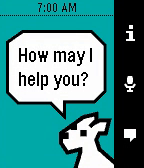
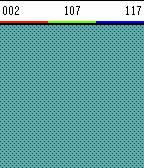
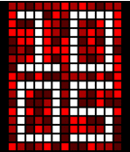
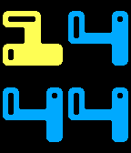

<!-- Generated by scripts/update_app_directory.py: do not edit by hand -->
[← All Pebble Developers](../developers.md)

# Mathew Reiss

*3 watchfaces and 2 apps · Last updated 2026-10-11 · [About these lists](../about-app-lists.md)*

Links: [Rebble App Store](https://apps.rebble.io/en_US/developer/52f02483af0eab7af50006d3/1) · [Pebble App Store](https://apps.repebble.com/apps/dev/mathew-reiss_52f02483af0eab7af50006d3) · [GitHub (MathewReiss)](https://github.com/MathewReiss) · [GitHub (pebble-dev)](https://github.com/pebble-dev) · [GitHub (rebootsramblings)](https://github.com/rebootsramblings) · [Website (mydogsnowy.com)](http://www.mydogsnowy.com)

<button type="button" data-filter="all" aria-pressed="true">All 5</button><button type="button" data-filter="watchface" aria-pressed="false">Watchfaces 3</button><button type="button" data-filter="watchapp" aria-pressed="false">Apps 2</button>

<label class="dev-sort">Sort by <select><option value="updated">Recently updated</option><option value="released">Newest release</option><option value="title">A–Z</option></select></label>

<h2 class="app-name" id="app-561960c8a1dd2652af00000d"><a href="https://apps.rebble.io/en_US/application/561960c8a1dd2652af00000d">Snowy</a> v4.5-rbl1</h2>
<a class="app-source" href="https://github.com/pebble-dev/snowy" title="Source code" data-search-exclude>View source</a>

App

Released 2015-10-10 Updated 2019-07-24 Rebble App Store

Runs on: Round 2, Time 2, Pebble 2 Duo, Pebble 2, Time Round, Time

Snowy is the most popular personal assistant for Pebble Time. Set reminders, translate sentences, control your home through IFTTT - you name it, and chances are Snowy can help you out. For just…

<h2 class="app-name" id="app-55846a486b94558b5f000024"><a href="https://apps.repebble.com/55846a486b94558b5f000024">Swatch</a> v1.1</h2>
<a class="app-source" href="https://github.com/MathewReiss/dithering" title="Source code" data-search-exclude>View source</a>

App

MIT Released 2015-06-19 Updated 2015-06-22

Runs on: Time 2, Time

Simple app to control individual R G B values and see the result of passing them into draw_dithered_rect_from_RGB. Uses Simple Dithering Library, available via the &quot;View Source&quot; link below.

<h2 class="app-name" id="app-557edb29352692214000001a"><a href="https://apps.repebble.com/557edb29352692214000001a">Pixel TS</a> v1.3</h2>
<a class="app-source" href="https://github.com/MathewReiss/pixel_time_steel/blob/master/src/main.c" title="Source code" data-search-exclude>View source</a>

Watchface

No licence Released 2015-06-15 Updated 2015-06-16

Runs on: Time 2, Time

I couldn&#x27;t find the watchface in the Pebble Time Steel pictures, so I made it! Enjoy: Pixel TS. Configurable colors include: Red, Purple, Blue, Green, Orange, Brown, and Rainbow!

<h2 class="app-name" id="app-557610f686a1e8eecd000082"><a href="https://apps.repebble.com/557610f686a1e8eecd000082">FORM</a> v1.1</h2>
<a class="app-source" href="https://github.com/rebootsramblings/GBitmap-Colour-Palette-Manipulator" title="Source code" data-search-exclude>View source</a>

Watchface

Released 2015-06-08 Updated 2015-06-09

Runs on: Time 2, Time

Reddit request - digital watchface in the same style as FORM for Android Wear (by Roman Nurik). All credit for design goes to Roman. If it proves popular, I&#x27;ll work on adding custom colors/themes!…

<h2 class="app-name" id="app-551d91875b2cb490c5000065"><a href="https://apps.repebble.com/551d91875b2cb490c5000065">Weather Ball</a> v1.4</h2>
<a class="app-source" href="http://www.github.com/MathewReiss/weather_ball" title="Source code" data-search-exclude>View source</a>

Watchface

No licence Released 2015-04-02 Updated 2015-05-27

Runs on: Time 2, Time

Weather Ball shows you the weather, in the simplest way possible, using color. Instead of icons or text, the weather is shown by setting the four digits of time to an easily recognizable pattern…

