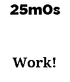

<!-- Generated by scripts/update_app_directory.py: do not edit by hand -->
[← All Pebble Developers](../developers.md)

# Matt Del Signore

*1 app · Last updated 2026-10-11 · [About these lists](../about-app-lists.md)*

Links: [Pebble App Store](https://apps.repebble.com/apps/dev/matt-del-signore_54baa79905d4eeddf500007f) · [GitHub (toastking)](https://github.com/toastking)

<h2 class="app-name" id="app-5674f3d17528c39387000094"><a href="https://apps.repebble.com/5674f3d17528c39387000094">Tomato Timer</a> v1.0</h2>
<a class="app-source" href="https://github.com/toastking/pebble_pomodoro" title="Source code" data-search-exclude>View source</a>

App

Released 2015-12-19 Updated 2015-12-19

Runs on: Time 2, Pebble 2 Duo, Pebble 2, Time, Classic

A timer for the Pomodoro Method!

