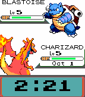
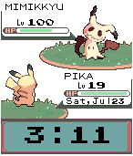

<!-- Generated by scripts/update_app_directory.py: do not edit by hand -->
[← All Pebble Developers](../developers.md)

# Matt Herron

*2 watchfaces · Last updated 2026-10-12 · [About these lists](../about-app-lists.md)*

Links: [Pebble App Store](https://apps.repebble.com/apps/dev/matt-herron_531a0f834969a222eb0001ac) · [GitHub (Nannoises)](https://github.com/Nannoises)

<button type="button" data-filter="all" aria-pressed="true">All 2</button><button type="button" data-filter="watchface" aria-pressed="false">Watchfaces 2</button><button type="button" data-filter="watchapp" aria-pressed="false" disabled>Apps 0</button>

<label class="dev-sort">Sort by <select><option value="updated">Recently updated</option><option value="released">Newest release</option><option value="title">A–Z</option></select></label>

<h2 class="app-name" id="app-560d6208038c38e6a6000016"><a href="https://apps.repebble.com/560d6208038c38e6a6000016">PokeBattle Color for Pebble Time</a> v2.3</h2>
<a class="app-source" href="https://github.com/Nannoises/PokeBattleColor" title="Source code" data-search-exclude>View source</a>

Watchface

No licence Released 2015-10-01 Updated 2025-12-01

Runs on: Time 2, Time

This is a watchface inspired by the awesome PokeBattle watchface. I wanted to make something similar for the pebble time, that took advantage of color. Ally Poke&#x27;mon level now uses Pebble Health…

<h2 class="app-name" id="app-5798fc871482cd61240000cd"><a href="https://apps.repebble.com/5798fc871482cd61240000cd">PokeBattle Custom</a> v1.2</h2>
<a class="app-source" href="https://github.com/Nannoises/PokeBattleColor/tree/StaticConfigurable" title="Source code" data-search-exclude>View source</a>

Watchface

No licence Released 2016-07-27 Updated 2018-04-27

Runs on: Round 2, Time 2, Time Round, Time

From the creator of PokeBattle Color comes PokeBattle Custom! Customize your PokeBattle watchface with whatever Pokémon you like. Features: -Customizable Pokémon sprites and names. -Pick 3…

