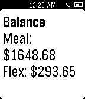
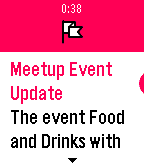
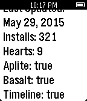
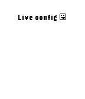
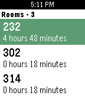

<!-- Generated by scripts/update_app_directory.py: do not edit by hand -->
[← All Pebble Developers](../developers.md)

# Matt Langlois

*5 apps · Last updated 2026-10-12 · [About these lists](../about-app-lists.md)*

Links: [Pebble App Store](https://apps.repebble.com/apps/dev/matt-langlois_52e30dd32645fb8bae000fcd) · [GitHub (fletchto99)](https://github.com/fletchto99) · [Website (fletchto99.com)](http://fletchto99.com)

<button type="button" data-filter="all" aria-pressed="true">All 5</button><button type="button" data-filter="watchface" aria-pressed="false" disabled>Watchfaces 0</button><button type="button" data-filter="watchapp" aria-pressed="false">Apps 5</button>

<label class="dev-sort">Sort by <select><option value="updated">Recently updated</option><option value="released">Newest release</option><option value="title">A–Z</option></select></label>

<h2 class="app-name" id="app-5468365c32e2d70d26000095"><a href="https://apps.repebble.com/5468365c32e2d70d26000095">uOttawa Card Manager</a> v2.05</h2>
<a class="app-source" href="https://github.com/fletchto99/uOttawa-Card-Pebble" title="Source code" data-search-exclude>View source</a>

App

No licence Released 2014-11-16 Updated 2016-02-16

Runs on: Round 2, Time 2, Pebble 2 Duo, Pebble 2, Time Round, Time, Classic

Allows University of Ottawa students to preform various actions on their uOttawa card. Actions include: - Check Flex &amp; Meal plan balance - Check history of last 10 Meal plan purchases - Check…

<h2 class="app-name" id="app-5539d8fdbf1a59d7ac000053"><a href="https://apps.repebble.com/5539d8fdbf1a59d7ac000053">Meetup</a> v2.22</h2>
<a class="app-source" href="https://github.com/fletchto99/Pebble-Meetup" title="Source code" data-search-exclude>View source</a>

App

No licence Released 2015-04-24 Updated 2016-02-16

Runs on: Round 2, Time 2, Pebble 2 Duo, Pebble 2, Time Round, Time, Classic

Keep on top of the upcoming Pebble &amp; Other meetup events/groups in your area! Actions include: - View Pebble meetup groups, world wide! - View upcoming Pebble meetup events within a configurable…

<h2 class="app-name" id="app-556bbaf730850a5fab000089"><a href="https://apps.repebble.com/556bbaf730850a5fab000089">Devboard</a> v1.10</h2>
<a class="app-source" href="https://github.com/fletchto99/pebble-devboard" title="Source code" data-search-exclude>View source</a>

App

No licence Released 2015-06-01 Updated 2016-02-16

Runs on: Round 2, Time 2, Pebble 2 Duo, Pebble 2, Time Round, Time, Classic

Enables the ability for pebble developers to view the status of their projects directly from their Pebble!

<h2 class="app-name" id="app-56bed5490ed2a75acd000040"><a href="https://apps.repebble.com/56bed5490ed2a75acd000040">Liveconfig Demo</a> v1.01</h2>
<a class="app-source" href="https://github.com/fletchto99/Pebble-liveconfig" title="Source code" data-search-exclude>View source</a>

App

MIT Released 2016-02-13 Updated 2016-02-13

Runs on: Round 2, Time 2, Pebble 2 Duo, Pebble 2, Time Round, Time, Classic

Demo of Live config library for developers!

<h2 class="app-name" id="app-56081e08f4e5610339000055"><a href="https://apps.repebble.com/56081e08f4e5610339000055">Roomer</a> v1.05</h2>
<a class="app-source" href="https://github.com/fletchto99/roomer-pebble" title="Source code" data-search-exclude>View source</a>

App

No licence Released 2015-09-27 Updated 2015-12-16

Runs on: Time 2, Pebble 2 Duo, Pebble 2, Time, Classic

Would you like to have a quiet place to study on campus? Do you find the libraries to be too crowded sometimes? If so, Roomer is the perfect app for you. Roomer lets you find an empty classroom on…

