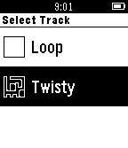

<!-- Generated by scripts/update_app_directory.py: do not edit by hand -->
[← All Pebble Developers](../developers.md)

# Matt Williams

*1 app · Last updated 2026-10-11 · [About these lists](../about-app-lists.md)*

Links: [Pebble App Store](https://apps.repebble.com/apps/dev/matt-williams_55857d247726b760780000b7) · [GitHub (matt-williams)](https://github.com/matt-williams)

<h2 class="app-name" id="app-558697acf14558ea410000a0"><a href="https://apps.repebble.com/558697acf14558ea410000a0">Kart</a> v1.1</h2>
<a class="app-source" href="https://github.com/matt-williams/pebble-kart" title="Source code" data-search-exclude>View source</a>

App

Released 2015-06-21 Updated 2015-06-23

Runs on: Time 2, Pebble 2 Duo, Pebble 2, Time, Classic

A kart-racing game for the Pebble Watch, controlled using the built-in accelerometer. Now working in colour on Pebble Time as well as original Pebble!

