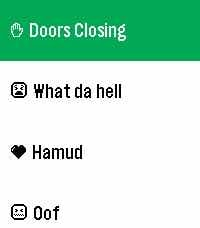
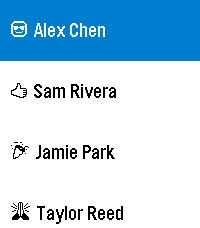

<!-- Generated by scripts/update_app_directory.py: do not edit by hand -->
[← All Pebble Developers](../developers.md)

# Matt

*2 apps · Last updated 2026-10-11 · [About these lists](../about-app-lists.md)*

Links: [Pebble App Store](https://apps.repebble.com/apps/dev/matt_e56a0276e82f3b9205e1cfb8) · [GitHub (mattnovelli)](https://github.com/mattnovelli) · [Website (discord.gg)](https://discord.gg/3AR2ypEC9Y)

<button type="button" data-filter="all" aria-pressed="true">All 2</button><button type="button" data-filter="watchface" aria-pressed="false" disabled>Watchfaces 0</button><button type="button" data-filter="watchapp" aria-pressed="false">Apps 2</button>

<label class="dev-sort">Sort by <select><option value="updated">Recently updated</option><option value="released">Newest release</option><option value="title">A–Z</option></select></label>

<h2 class="app-name" id="app-05a900301a1642d4a086e782"><a href="https://apps.repebble.com/05a900301a1642d4a086e782">Soundboard</a> v1.0.1</h2>
<a class="app-source" href="https://github.com/mattnovelli/soundboard" title="Source code" data-search-exclude>View source</a>

App

Released 2026-07-12 Updated 2026-07-24

Runs on: Round 2, Time 2

Pick sounds from your phone. Play them through your Pebble&#x27;s speakers. All-on device. It&#x27;s that simple, folks.

<h2 class="app-name" id="app-87448e2399a94cd58d2c8284"><a href="https://apps.repebble.com/87448e2399a94cd58d2c8284">Patch</a> v1.1.0</h2>
<a class="app-source" href="https://github.com/mattnovelli/patch" title="Source code" data-search-exclude>View source</a>

App · <a href="https://forum.rebble.io/t/958" title="Discuss this app on the Rebble forum" data-search-exclude>Forum thread</a>

Released 2026-05-08 Updated 2026-07-12

Runs on: Round 2, Time 2, Time Round, Time

Harness the power of iOS Automations to send text messages (including iMessages) from your Pebble! No server required. Patch uses Outlook (yes, Outlook!) to send an email to yourself, which…

