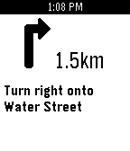

<!-- Generated by scripts/update_app_directory.py: do not edit by hand -->
[← All Pebble Developers](../developers.md)

# Matteo Miceli

*1 app · Last updated 2026-10-11 · [About these lists](../about-app-lists.md)*

Links: [Pebble App Store](https://apps.repebble.com/apps/dev/matteo-miceli_334a6176a0e49c37a49775c1) · [GitHub (matteomiceli)](https://github.com/matteomiceli)

<h2 class="app-name" id="app-613a872008144c7eb0404912"><a href="https://apps.repebble.com/613a872008144c7eb0404912">Pebble Pilot</a> v0.2</h2>
<a class="app-source" href="https://github.com/matteomiceli/pebble-pilot" title="Source code" data-search-exclude>View source</a>

App

Released 2026-06-06 Updated 2026-06-30

Runs on: Time 2, Pebble 2 Duo

A minimal turn-by-turn navigation app. Features - Configurable destination with location auto-complete - Automatic manuever detection - Shows the distance to manuever Setup 1. Setup an…

