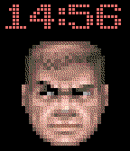

<!-- Generated by scripts/update_app_directory.py: do not edit by hand -->
[← All Pebble Developers](../developers.md)

# Matteo Piccina

*2 watchfaces · Last updated 2026-10-11 · [About these lists](../about-app-lists.md)*

Links: [Pebble App Store](https://apps.repebble.com/apps/dev/matteo-piccina_52f10e8d3be6208c1f0020a5) · [GitHub (cipi1965)](https://github.com/cipi1965) · [GitHub (realguarroman)](https://github.com/realguarroman) · [Website (twitter.com)](http://twitter.com/guarroman)

<button type="button" data-filter="all" aria-pressed="true">All 2</button><button type="button" data-filter="watchface" aria-pressed="false">Watchfaces 2</button><button type="button" data-filter="watchapp" aria-pressed="false" disabled>Apps 0</button>

<label class="dev-sort">Sort by <select><option value="updated">Recently updated</option><option value="released">Newest release</option><option value="title">A–Z</option></select></label>

<h2 class="app-name" id="app-544f8cc6dc21b70fe9000056"><a href="https://apps.repebble.com/544f8cc6dc21b70fe9000056">jarl</a> v2.6</h2>
<a class="app-source" href="https://github.com/cipi1965/Jarl-Pebble" title="Source code" data-search-exclude>View source</a>

Watchface

Released 2014-10-28 Updated 2026-04-15

Runs on: Time 2, Pebble 2 Duo, Pebble 2, Time, Classic

jarl (the name of the watchface) is a tribute to spanish comedian Chiquito de la Calzada You can see the date, temperature and weather conditions shaking your wrist. This watchface doesn&#x27;t use any…

<h2 class="app-name" id="app-573dbd6d0d6148012f00000b"><a href="https://apps.repebble.com/573dbd6d0d6148012f00000b">Doom Guy</a> v1.5</h2>
<a class="app-source" href="https://github.com/realguarroman/doomguy" title="Source code" data-search-exclude>View source</a>

Watchface

Released 2016-05-19 Updated 2016-11-09

Runs on: Round 2, Time 2, Time Round, Time

At last! Doomguy goes with you on your wrist! You can choose from two behaviors: - Doomguy health decreases as your Pebble&#x27;s battery runs out - Doomguy tracks your activity. If you don&#x27;t move Doom…

