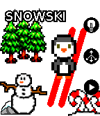
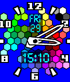
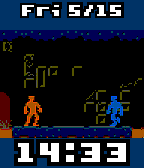
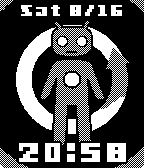
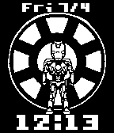

<!-- Generated by scripts/update_app_directory.py: do not edit by hand -->
[← All Pebble Developers](../developers.md)

# Matthew Hungerford

*11 watchfaces and 4 apps · Last updated 2026-10-11 · [About these lists](../about-app-lists.md)*

Links: [Pebble App Store](https://apps.repebble.com/apps/dev/matthew-hungerford_52bca741d438930a650001b6) · [GitHub (mhungerford)](https://github.com/mhungerford) · [Website (xkcd.com)](http://xkcd.com)

<button type="button" data-filter="all" aria-pressed="true">All 15</button><button type="button" data-filter="watchface" aria-pressed="false">Watchfaces 11</button><button type="button" data-filter="watchapp" aria-pressed="false">Apps 4</button>

<label class="dev-sort">Sort by <select><option value="updated">Recently updated</option><option value="released">Newest release</option><option value="title">A–Z</option></select></label>

<h2 class="app-name" id="app-52f0253c4ae3633a6400083a"><a href="https://apps.repebble.com/52f0253c4ae3633a6400083a">XKCD Comic</a> v2.2</h2>
<a class="app-source" href="https://github.com/mhungerford/png_xkcd" title="Source code" data-search-exclude>View source</a>

App

Released 2014-02-03 Updated 2015-12-18

Runs on: Round 2, Time 2, Pebble 2 Duo, Pebble 2, Time Round, Time, Classic

Update: More comics, now resumes where you left off. XKCD is webcomic about sarcasm, math, technology, and science. XCDK is licensed under the Creative Commons (CC BY-NC 2.5). uPNG ported for &gt;70…

<h2 class="app-name" id="app-5592dc3e53d39fc50500006b"><a href="https://apps.repebble.com/5592dc3e53d39fc50500006b">Fireworks (Particle Effects + Glancing)</a> v2.0</h2>
<a class="app-source" href="https://github.com/mhungerford/pebble_fireworks" title="Source code" data-search-exclude>View source</a>

Watchface

Released 2015-06-30 Updated 2015-10-05

Runs on: Round 2, Time 2, Time Round, Time

Fireworks Watchface featuring fireworks created using particle effects with random colors and trajectory and offscreen renderer allowing for composited trails and particle decay. Utilizes…

<h2 class="app-name" id="app-556bf9c4389795518100008d"><a href="https://apps.repebble.com/556bf9c4389795518100008d">SnowSki</a> v1.0</h2>
<a class="app-source" href="https://github.com/mhungerford" title="Source code" data-search-exclude>View source</a>

App

Released 2015-06-01 Updated 2015-06-11

Runs on: Time 2, Time

Pixel Penguin skis downhill avoiding trees, rocks, snowmen and other miscellaneous obstacles. Tilt the pebble to steer down the hill. You get 3 lives, and every 100 points things get faster. All…

<h2 class="app-name" id="app-5568d33d073e041f5e000046"><a href="https://apps.repebble.com/5568d33d073e041f5e000046">ColorHex</a> v1.0</h2>
<a class="app-source" href="http://github.com/mhungerford" title="Source code" data-search-exclude>View source</a>

Watchface

Released 2015-05-29 Updated 2015-05-29

Runs on: Time 2, Time

Analog watchface featuring the Pebble 64-color palette as a background. Anti-aliased watchhands Bordered hour markers Digital LCD readout of date and time with transparent mesh background for…

<h2 class="app-name" id="app-5556eaf92696c74d06000084"><a href="https://apps.repebble.com/5556eaf92696c74d06000084">RetroFight</a> v1.0</h2>
<a class="app-source" href="https://github.com/mhungerford" title="Source code" data-search-exclude>View source</a>

Watchface

Released 2015-05-16 Updated 2015-05-16

Runs on: Time 2, Time

Animated sword fight with retro graphics. Animates on flick (to conserve power). created using animation from opengameart.org…

<h2 class="app-name" id="app-5556f803ef1c15c24800008c"><a href="https://apps.repebble.com/5556f803ef1c15c24800008c">Hexeosis Time</a> v1.1</h2>
<a class="app-source" href="https://github.com/mhungerford" title="Source code" data-search-exclude>View source</a>

Watchface

Released 2015-05-16 Updated 2015-05-16

Runs on: Time 2, Time

Hexagon kaleidoscope of colors Animation created by hexeosis: http://hexeosis.tumblr.com

<h2 class="app-name" id="app-55566afbef1c155748000039"><a href="https://apps.repebble.com/55566afbef1c155748000039">Nyan Cat</a> v1.0</h2>
<a class="app-source" href="https://github.com/mhungerford" title="Source code" data-search-exclude>View source</a>

Watchface

Released 2015-05-15 Updated 2015-05-15

Runs on: Time 2, Time

Nyan Cat for Pebble Animates on Flick visit http://www.nyan.cat

<h2 class="app-name" id="app-54c6b3c8c5de00257c00006c"><a href="https://apps.repebble.com/54c6b3c8c5de00257c00006c">Hero Morph</a> v1.1</h2>
<a class="app-source" href="https://github.com/mhungerford" title="Source code" data-search-exclude>View source</a>

Watchface

Released 2015-01-26 Updated 2015-01-26

Runs on: Time 2, Pebble 2 Duo, Pebble 2, Time, Classic

See your favorite superheroes and supervillians morph into each other. Includes: Batman, Superman, Captain America, Wolverine, Iron man, Flash, Spiderman, Magneto, Hulk, Red Skull, Venom, Joker…

<h2 class="app-name" id="app-545059ca1c9d3823c0000010"><a href="https://apps.repebble.com/545059ca1c9d3823c0000010">Halloween Time</a> v1.0</h2>
<a class="app-source" href="https://github.com/mhungerford/pebble-halloween_time" title="Source code" data-search-exclude>View source</a>

Watchface

Released 2014-10-29 Updated 2014-10-29

Runs on: Time 2, Pebble 2 Duo, Pebble 2, Time, Classic

Happy Halloween! Flick your wrist to flip through fun Halloween images. Grim Reaper &amp; Vampire images from clipartlord.com Zombie &amp; Frankenstein images CC-3.0 from Vladimir Zuñiga of Foca.tk…

<h2 class="app-name" id="app-53f044967bb7290eb100003c"><a href="https://apps.repebble.com/53f044967bb7290eb100003c">CyanogenMod - CID animated watchface</a> v1.0</h2>
<a class="app-source" href="http://github.com/mhungerford" title="Source code" data-search-exclude>View source</a>

Watchface

Released 2014-08-17 Updated 2014-08-17

Runs on: Time 2, Pebble 2 Duo, Pebble 2, Time, Classic

Flick your wrist to power up CID. Android boot animation featuring CID from Cyanogenmod, created by Xevin: https://www.youtube.com/watch?v=o05PQRO1UW4 Thanks CyanogenMod Team for the amazing…

<h2 class="app-name" id="app-53960f64261143288500011f"><a href="https://apps.repebble.com/53960f64261143288500011f">PebbleGL 3D</a> v1.0.0</h2>
<a class="app-source" href="https://github.com/mhungerford/PebbleGL" title="Source code" data-search-exclude>View source</a>

App

Released 2014-06-09 Updated 2014-07-21

Runs on: Time 2, Pebble 2 Duo, Pebble 2, Time, Classic

OpenGL for Pebble. Provides minimal OpenGL 1.1 engine for rendering 3D graphics. Renders STL models in both wireframe and filled with positional lighting sources. Top button changes angle, middle…

<h2 class="app-name" id="app-53b8688ff92e8f527a00003f"><a href="https://apps.repebble.com/53b8688ff92e8f527a00003f">Iron Man - ironman animated watchface</a> v1.0.0</h2>
<a class="app-source" href="http://github.com/mhungerford" title="Source code" data-search-exclude>View source</a>

Watchface

Released 2014-07-05 Updated 2014-07-05

Runs on: Time 2, Pebble 2 Duo, Pebble 2, Time, Classic

Assemble Iron Man&#x27;s armor by flicking your Pebble. Uses 77 frames to create the ~ 15 second animation. Original animation by z-studios on deviant art…

<h2 class="app-name" id="app-53a7ae068297bed91d0000d2"><a href="https://apps.repebble.com/53a7ae068297bed91d0000d2">Tron - animated racer</a> v1.0.0</h2>
<a class="app-source" href="https://github.com/mhungerford" title="Source code" data-search-exclude>View source</a>

Watchface

Released 2014-06-23 Updated 2014-06-23

Runs on: Time 2, Pebble 2 Duo, Pebble 2, Time, Classic

Tron animated watchface. Flick your wrist to see 10 seconds of 8-bit tron animation from Pierre Manry... youtube.com/watch?v=G2DzuumNbgc

<h2 class="app-name" id="app-5349f76e085291de2e0000fa"><a href="https://apps.repebble.com/5349f76e085291de2e0000fa">OpenGameArt.org</a> v1.1</h2>
<a class="app-source" href="https://github.com/mhungerford/pebble-OpenGameArt.org" title="Source code" data-search-exclude>View source</a>

Watchface

Released 2014-04-13 Updated 2014-05-19

Runs on: Time 2, Pebble 2 Duo, Pebble 2, Time, Classic

Flick your wrist to flip through 11 images from OpenGameArt.org. OpenGameArt.org is a site providing art licensed under Creative-Commons. Outline Font is based on the Boxy font also found on…

<h2 class="app-name" id="app-52eaaa9026dfc38c0e000010"><a href="https://apps.repebble.com/52eaaa9026dfc38c0e000010">Mandelbrot Generator</a> v1.0.0</h2>
<a class="app-source" href="https://github.com/mhungerford/pebble-mandelbrot-generator" title="Source code" data-search-exclude>View source</a>

App

Released 2014-01-30 Updated 2014-01-30

Runs on: Time 2, Pebble 2 Duo, Pebble 2, Time, Classic

Renders interesting regions of the Mandelbrot set, regenerating the image at each level. Uses fastmath and direct framebuffer and on watch dithering (4-bit to 1-bit).

