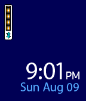

<!-- Generated by scripts/update_app_directory.py: do not edit by hand -->
[← All Pebble Developers](../developers.md)

# Matthew Klundt

*1 watchface · Last updated 2026-10-11 · [About these lists](../about-app-lists.md)*

Links: [Pebble App Store](https://apps.repebble.com/apps/dev/matthew-klundt_54ca7969c967f922c2000056) · [GitHub (mattfox12)](https://github.com/mattfox12)

<h2 class="app-name" id="app-55c8ef366aeaee8c9c000020"><a href="https://apps.repebble.com/55c8ef366aeaee8c9c000020">Mega Watchface</a> v1.0</h2>
<a class="app-source" href="https://github.com/mattfox12/mega_watchface" title="Source code" data-search-exclude>View source</a>

Watchface

Released 2015-08-10 Updated 2015-08-11

Runs on: Time 2, Pebble 2 Duo, Pebble 2, Time, Classic

Watchface in the style of Mega Man X. Shows Bluetooth connection and battery life as the life meter.

