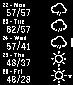

<!-- Generated by scripts/update_app_directory.py: do not edit by hand -->
[← All Pebble Developers](../developers.md)

# Matthew McClellan

*1 app · Last updated 2026-10-12 · [About these lists](../about-app-lists.md)*

Links: [Pebble App Store](https://apps.repebble.com/apps/dev/matthew-mcclellan_52cbc5afb138282b75000118) · [GitHub (mcclellanmj)](https://github.com/mcclellanmj)

<h2 class="app-name" id="app-56cbf445ad30ff6e3b00000e"><a href="https://apps.repebble.com/56cbf445ad30ff6e3b00000e">Express Forecast</a> v1.1</h2>
<a class="app-source" href="https://github.com/mcclellanmj/pebble-quick-weather" title="Source code" data-search-exclude>View source</a>

App

Released 2016-02-23 Updated 2016-06-22

Runs on: Time 2, Pebble 2 Duo, Pebble 2, Time, Classic

A straight-to-the-point watchapp for getting the weather. Will give the next 10 days forecast as soon as its opened. The intention of this app was to answer the question &quot;What&#x27;s the weather like…

