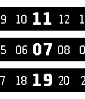

<!-- Generated by scripts/update_app_directory.py: do not edit by hand -->
[← All Pebble Developers](../developers.md)

# Matthew Tole

*2 watchfaces and 3 apps · Last updated 2026-10-12 · [About these lists](../about-app-lists.md)*

Links: [Pebble App Store](https://apps.repebble.com/apps/dev/matthew-tole_5283d2a9c0b0168bf6000001) · [GitHub (smallstoneapps)](https://github.com/smallstoneapps) · [Website (matthewtole.com)](http://matthewtole.com/pebble/hearts/)

<button type="button" data-filter="all" aria-pressed="true">All 5</button><button type="button" data-filter="watchface" aria-pressed="false">Watchfaces 2</button><button type="button" data-filter="watchapp" aria-pressed="false">Apps 3</button>

<label class="dev-sort">Sort by <select><option value="updated">Recently updated</option><option value="released">Newest release</option><option value="title">A–Z</option></select></label>

<h2 class="app-name" id="app-530be07a7cd17c954e000049"><a href="https://apps.repebble.com/530be07a7cd17c954e000049">Hearts</a> v6.0</h2>
<a class="app-source" href="http://github.com/smallstoneapps/hearts/" title="Source code" data-search-exclude>View source</a>

App

MIT Released 2014-02-25 Updated 2016-09-17

Runs on: Round 2, Time 2, Pebble 2 Duo, Pebble 2, Time Round, Time, Classic

Keep an eye on how popular your apps are on the Pebble appstore with this amazing app.

<h2 class="app-name" id="app-52d3086712ea3dec7e00001b"><a href="https://apps.repebble.com/52d3086712ea3dec7e00001b">UK Transport</a> v1.8</h2>
<a class="app-source" href="http://github.com/smallstoneapps/uk-transport/" title="Source code" data-search-exclude>View source</a>

App

No licence Released 2014-01-12 Updated 2015-07-27

Runs on: Time 2, Pebble 2 Duo, Pebble 2, Time, Classic

The must have Pebble app for people who use UK public transport. Look up upcoming bus and train departures from your closest stops and stations, and mark your favourites for easy access in the…

<h2 class="app-name" id="app-52d90af49f5788bcb000000d"><a href="https://apps.repebble.com/52d90af49f5788bcb000000d">Dots</a> v2.2</h2>
<a class="app-source" href="http://github.com/smallstoneapps/dots/" title="Source code" data-search-exclude>View source</a>

Watchface

MIT Released 2014-01-17 Updated 2015-05-20

Runs on: Time 2, Pebble 2 Duo, Pebble 2, Time, Classic

Show the time as a collection of dots, one for each hour, minute, and second in the day.

<h2 class="app-name" id="app-52d30a1d19412b4d84000025"><a href="https://apps.repebble.com/52d30a1d19412b4d84000025">Multi Timer</a> v3.4</h2>
<a class="app-source" href="http://github.com/smallstoneapps/multi-timer/" title="Source code" data-search-exclude>View source</a>

App

MIT Released 2014-01-12 Updated 2015-01-02

Runs on: Time 2, Pebble 2 Duo, Pebble 2, Time, Classic

Multi Timer is simply the best timer and stopwatch app for Pebble. You can create as many independent timers and stopwatches as you need. With the release of 3.0, timers will now launch the app…

<h2 class="app-name" id="app-52d3b4dcf659f068e0000014"><a href="https://apps.repebble.com/52d3b4dcf659f068e0000014">Sliders</a> v2.3</h2>
<a class="app-source" href="http://github.com/smallstoneapps/sliders/" title="Source code" data-search-exclude>View source</a>

Watchface

MIT Released 2014-01-13 Updated 2014-12-05

Runs on: Time 2, Pebble 2 Duo, Pebble 2, Time, Classic

A simple watchface for viewing the time.

