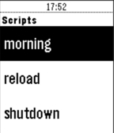

<!-- Generated by scripts/update_app_directory.py: do not edit by hand -->
[← All Pebble Developers](../developers.md)

# Matthias Hutsebaut

*1 app · Last updated 2026-10-11 · [About these lists](../about-app-lists.md)*

Links: [Rebble App Store](https://apps.rebble.io/en_US/developer/57c9ffdfbe5ad0936b000114/1) · [GitHub (mhtsbt)](https://github.com/mhtsbt)

<h2 class="app-name" id="app-5a4533bf461a8d60350019d9"><a href="https://apps.rebble.io/en_US/application/5a4533bf461a8d60350019d9">HomeAssistant</a> v1.0</h2>
<a class="app-source" href="https://github.com/mhtsbt/PebbleHomeAssistant" title="Source code" data-search-exclude>View source</a>

App

Released 2017-12-28 Updated 2017-12-28 Rebble App Store

Runs on: Time 2, Time

This app allows to trigger home-assistant scripts on your watch!

