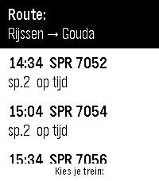

<!-- Generated by scripts/update_app_directory.py: do not edit by hand -->
[← All Pebble Developers](../developers.md)

# Matthijsvdww

*1 app · Last updated 2026-10-11 · [About these lists](../about-app-lists.md)*

Links: [Pebble App Store](https://apps.repebble.com/apps/dev/matthijsvdww_1f7e9b47e8b8bd0f4b287b13) · [GitHub (Matthijsvdww)](https://github.com/Matthijsvdww)

<h2 class="app-name" id="app-ae3f1445b08449f28c0069ff"><a href="https://apps.repebble.com/ae3f1445b08449f28c0069ff">Treinreisplanner</a> v1.4.0</h2>
<a class="app-source" href="https://github.com/Matthijsvdww/Pebble-Treinreisplanner" title="Source code" data-search-exclude>View source</a>

App

No licence Released 2026-09-04 Updated 2026-09-07

Runs on: Time 2

Let op: pure vibecode. Heb de meeste bugs er proberen uit te halen, maar dit is vooral een persoonlijk project wat toch nog wel handig is geworden. Als je vragen hebt, kun je me vinden op Discord…

