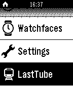

<!-- Generated by scripts/update_app_directory.py: do not edit by hand -->
[← All Pebble Developers](../developers.md)

# mattmb

*1 app · Last updated 2026-10-11 · [About these lists](../about-app-lists.md)*

Links: [Pebble App Store](https://apps.repebble.com/apps/dev/mattmb_52b86238200b9b1de200002d) · [GitHub (mattmb)](https://github.com/mattmb)

<h2 class="app-name" id="app-52cb3fbf45ffdd11e6000090"><a href="https://apps.repebble.com/52cb3fbf45ffdd11e6000090">Last Tube London</a> v1.0.1</h2>
<a class="app-source" href="https://github.com/mattmb/pebble-last-tube" title="Source code" data-search-exclude>View source</a>

App

Released 2014-01-06 Updated 2014-01-18

Runs on: Time 2, Pebble 2 Duo, Pebble 2, Time, Classic

This app finds the last tube at nearby stations in London. It finds the three nearest stations and then finds the last tubes on all lines. Disclaimers: This app is not endorsed by TfL although it…

