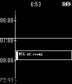

<!-- Generated by scripts/update_app_directory.py: do not edit by hand -->
[← All Pebble Developers](../developers.md)

# Matzo

*1 app · Last updated 2026-10-11 · [About these lists](../about-app-lists.md)*

Links: [Rebble App Store](https://apps.rebble.io/en_US/developer/52f1700cc41172eebc0006f8/1) · [GitHub (Matzo)](https://github.com/Matzo)

<h2 class="app-name" id="app-53e3f86af2e150c76c000049"><a href="https://apps.rebble.io/en_US/application/53e3f86af2e150c76c000049">TimeSchedule</a> v1.5</h2>
<a class="app-source" href="https://github.com/Matzo/PebbleTimeSchuedule" title="Source code" data-search-exclude>View source</a>

App

No licence Released 2014-08-07 Updated 2015-04-12 Rebble App Store

Runs on: Time 2, Pebble 2 Duo, Pebble 2, Time, Classic

Display today&#x27;s your time schedule on Pebble. You can send your schedule to Pebble from iOS companion app. http://appstore.com/PebbleTimeSchedule REQUIRED: Pebble TimeSchedule for iOS (v1.1) Next…

