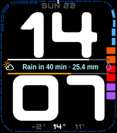

<!-- Generated by scripts/update_app_directory.py: do not edit by hand -->
[← All Pebble Developers](../developers.md)

# Maurin

*1 watchface · Last updated 2026-11-23 · [About these lists](../about-app-lists.md)*

Links: [Rebble App Store](https://apps.rebble.io/en_US/developer/68f3d20d69551c0009c36047/1) · [GitHub (maurinkne-coder)](https://github.com/maurinkne-coder)

<h2 class="app-name" id="app-6b0342f3566c71000bc7940b"><a href="https://apps.rebble.io/en_US/application/6b0342f3566c71000bc7940b">Drizzle</a> v1.0.1</h2>
<a class="app-source" href="https://github.com/maurinkne-coder/minimal-weather-face" title="Source code" data-search-exclude>View source</a>

Watchface · <a href="https://forum.rebble.io/t/1546" title="Discuss this app on the Rebble forum" data-search-exclude>Forum thread</a>

No licence Released 2026-11-22 Updated 2026-11-22 Rebble App Store

Runs on: Round 2, Time 2

A big, bold clock with the coming rain drawn as bars round the edge. Now is at the top, the next hours run clockwise. - Bar colours show how strong the rain is; solid means likely, outlined means…

