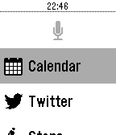

<!-- Generated by scripts/update_app_directory.py: do not edit by hand -->
[← All Pebble Developers](../developers.md)

# Max Bäumle

*1 watchface and 1 app · Last updated 2026-10-11 · [About these lists](../about-app-lists.md)*

Links: [Rebble App Store](https://apps.rebble.io/en_US/developer/529e272138dd3faefd00001f/1) · [GitHub (maxbaeumle)](https://github.com/maxbaeumle) · [GitHub (JamesFowler42)](https://github.com/JamesFowler42) · [Website (smartwatch.pro)](http://smartwatch.pro)

<button type="button" data-filter="all" aria-pressed="true">All 2</button><button type="button" data-filter="watchface" aria-pressed="false">Watchfaces 1</button><button type="button" data-filter="watchapp" aria-pressed="false">Apps 1</button>

<label class="dev-sort">Sort by <select><option value="updated">Recently updated</option><option value="released">Newest release</option><option value="title">A–Z</option></select></label>

<h2 class="app-name" id="app-52ac94f731a5fa35c500001d"><a href="https://apps.rebble.io/en_US/application/52ac94f731a5fa35c500001d">Smartwatch Pro</a> v2.0</h2>
<a class="app-source" href="https://github.com/maxbaeumle/smartwatchface" title="Source code" data-search-exclude>View source</a>

App

Released 2013-12-14 Updated 2016-09-23 Rebble App Store

Runs on: Round 2, Time 2, Pebble 2 Duo, Pebble 2, Time Round, Time, Classic

Provides useful additional functionality with your Pebble watch including displaying upcoming calendar events, your Twitter timeline, step count and more. &quot;Best Technical Achievement&quot; - Pebble…

<h2 class="app-name" id="app-56850e365ce44af3590000aa"><a href="https://apps.rebble.io/en_US/application/56850e365ce44af3590000aa">Modern Calendar</a> v1.2</h2>
<a class="app-source" href="https://github.com/JamesFowler42/moderncalendar" title="Source code" data-search-exclude>View source</a>

Watchface

No licence Released 2015-12-31 Updated 2015-12-31 Rebble App Store

Runs on: Time 2, Pebble 2 Duo, Pebble 2, Time, Classic

Calendar alert watchface for Smartwatch Pro

