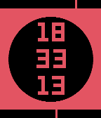
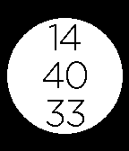

<!-- Generated by scripts/update_app_directory.py: do not edit by hand -->
[← All Pebble Developers](../developers.md)

# Max Beckett

*3 watchfaces · Last updated 2026-10-11 · [About these lists](../about-app-lists.md)*

Links: [Pebble App Store](https://apps.repebble.com/apps/dev/max-beckett_547aefed735193e6ce00000c) · [Rebble App Store](https://apps.rebble.io/en_US/developer/547aefed735193e6ce00000c/1) · [GitHub (mlb406)](https://github.com/mlb406)

<button type="button" data-filter="all" aria-pressed="true">All 3</button><button type="button" data-filter="watchface" aria-pressed="false">Watchfaces 3</button><button type="button" data-filter="watchapp" aria-pressed="false" disabled>Apps 0</button>

<label class="dev-sort">Sort by <select><option value="updated">Recently updated</option><option value="released">Newest release</option><option value="title">A–Z</option></select></label>

<h2 class="app-name" id="app-56d222421f7ad629b6000041"><a href="https://apps.repebble.com/56d222421f7ad629b6000041">Circular Plus v2</a> v2.3</h2>
<a class="app-source" href="https://github.com/mlb406/circular-v2" title="Source code" data-search-exclude>View source</a>

Watchface

Released 2016-02-27 Updated 2016-03-09

Runs on: Time 2, Pebble 2 Duo, Pebble 2, Time, Classic

Circular Plus v2 is a follow up of my watchface Circular+. It has been completely rewritten with SDK 3.x and has been optimised for the latest firmware. Unfortunately, not all features have yet…

<h2 class="app-name" id="app-55f9c3d9acde1796ce000084"><a href="https://apps.rebble.io/en_US/application/55f9c3d9acde1796ce000084">Timetable Time</a> v1.0</h2>
<a class="app-source" href="https://github.com/mlb406/Timetable_Time" title="Source code" data-search-exclude>View source</a>

Watchface

Released 2015-09-16 Updated 2015-09-16 Rebble App Store

Runs on: Time 2, Pebble 2 Duo, Pebble 2, Time, Classic

Timetable Time is a watchface designed for students. You can enter your timetable for each day, and it will pop up for the day it is. It also has a battery display and the date Features planned: …

<h2 class="app-name" id="app-55b393357d33ce09d8000059"><a href="https://apps.repebble.com/55b393357d33ce09d8000059">CircularPlus</a> v1.0</h2>
<a class="app-source" href="https://github.com/mlb406/CircularFace" title="Source code" data-search-exclude>View source</a>

Watchface

Released 2015-07-25 Updated 2015-07-25

Runs on: Time 2, Pebble 2 Duo, Pebble 2, Time, Classic

Meet CircularPlus. CircularPlus is a watchface for Pebble, that has several configurable options. Although tested predominantly on Pebble Original, the face should also work on Pebble Time and…

