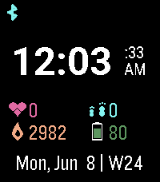

<!-- Generated by scripts/update_app_directory.py: do not edit by hand -->
[← All Pebble Developers](../developers.md)

# Max Mehl

*1 watchface · Last updated 2026-10-12 · [About these lists](../about-app-lists.md)*

Links: [Pebble App Store](https://apps.repebble.com/apps/dev/max-mehl_8dcbffb3d94bf558f49ff8d7) · [GitHub (mxmehl)](https://github.com/mxmehl)

<h2 class="app-name" id="app-1c84d2017ade47e594a76f20"><a href="https://apps.repebble.com/1c84d2017ade47e594a76f20">Clean Overview</a> v1.0.0</h2>
<a class="app-source" href="https://github.com/mxmehl/pebble-clean-overview" title="Source code" data-search-exclude>View source</a>

Watchface

Released 2026-06-07 Updated 2026-06-07

Runs on: Time 2

A clean, minimal digital watchface with health stats at a glance. Large time display, configurable seconds (always/on shake), Bluetooth and quiet time indicators, heart rate, steps, calories, and…

