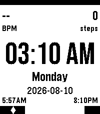

<!-- Generated by scripts/update_app_directory.py: do not edit by hand -->
[← All Pebble Developers](../developers.md)

# Max-q-rockets

*1 watchface · Last updated 2026-10-11 · [About these lists](../about-app-lists.md)*

Links: [Pebble App Store](https://apps.repebble.com/apps/dev/unknown_d9a7fde7c50c10a226af0ed1) · [GitHub (Max-q-rockets)](https://github.com/Max-q-rockets)

<h2 class="app-name" id="app-aea24cf36e484878ae9c806e"><a href="https://apps.repebble.com/aea24cf36e484878ae9c806e">Max&#x27;s minimalist watchface</a> v0.0.7</h2>
<a class="app-source" href="https://github.com/Max-q-rockets/MinimalistPebbleTime2Face" title="Source code" data-search-exclude>View source</a>

Watchface

No licence Released 2026-08-11 Updated 2026-08-26

Runs on: Time 2

Minimalist watchface displaying battery, heart rate and step count, as well as sunrise and sunset time.

