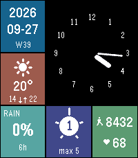

<!-- Generated by scripts/update_app_directory.py: do not edit by hand -->
[← All Pebble Developers](../developers.md)

# Max

*1 watchface · Last updated 2026-10-11 · [About these lists](../about-app-lists.md)*

Links: [Pebble App Store](https://apps.repebble.com/apps/dev/max_7383942784c5ab4602dd8dc0) · [GitHub (max-tet)](https://github.com/max-tet)

<h2 class="app-name" id="app-7bec989c6c01406e98acfcd2"><a href="https://apps.repebble.com/7bec989c6c01406e98acfcd2">Metro Analog</a> v1.2.0</h2>
<a class="app-source" href="https://github.com/max-tet/pebble-metro-analog" title="Source code" data-search-exclude>View source</a>

Watchface

Released 2026-09-20 Updated 2026-09-27

Runs on: Time 2

A Metro tile grid for the Pebble Time 2. An analog clock with all twelve numerals fills the top left, and the remaining tiles carry the ISO date with week number, current weather with high and…

