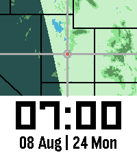

<!-- Generated by scripts/update_app_directory.py: do not edit by hand -->
[← All Pebble Developers](../developers.md)

# MaxDViper

*2 watchfaces · Last updated 2026-10-11 · [About these lists](../about-app-lists.md)*

Links: [Pebble App Store](https://apps.repebble.com/apps/dev/maxdviper_e52f453653c79ea144c77df3) · [GitHub (MaxDViper)](https://github.com/MaxDViper)

<button type="button" data-filter="all" aria-pressed="true">All 2</button><button type="button" data-filter="watchface" aria-pressed="false">Watchfaces 2</button><button type="button" data-filter="watchapp" aria-pressed="false" disabled>Apps 0</button>

<label class="dev-sort">Sort by <select><option value="updated">Recently updated</option><option value="released">Newest release</option><option value="title">A–Z</option></select></label>

<h2 class="app-name" id="app-9258e58695ce4442aa5c1ccb"><a href="https://apps.repebble.com/9258e58695ce4442aa5c1ccb">Where In Utah</a> v2.0.0</h2>
<a class="app-source" href="https://github.com/MaxDViper/Where_In_Utah_Watchface" title="Source code" data-search-exclude>View source</a>

Watchface

No licence Released 2026-08-26 Updated 2026-08-26

Runs on: Time 2, Pebble 2 Duo, Pebble 2, Time, Classic

If you saw the World Map Watchfaces and wanted something more zoomed into your location, this series of watchfaces are for you. Open for requests for future areas. I may or may not be able to…

<h2 class="app-name" id="app-605c300924b745c7b28036e1"><a href="https://apps.repebble.com/605c300924b745c7b28036e1">Where In The World Pix Style</a> v2.0</h2>
<a class="app-source" href="https://github.com/MaxDViper/Where_In_The_World_Watchface" title="Source code" data-search-exclude>View source</a>

Watchface

MIT Released 2026-05-22 Updated 2026-05-22

Runs on: Time 2, Pebble 2 Duo, Pebble 2, Time, Classic

Inspired by the &quot;pebble-day-night-pix&quot; Watchface by David Gianforte with a pixelized version of a world map and the &quot;Time Traveler&quot; App by Freakified. This watchface is the result of finding a…

