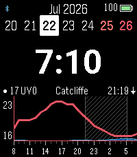
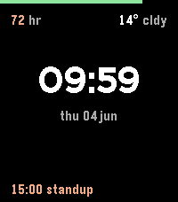

<!-- Generated by scripts/update_app_directory.py: do not edit by hand -->
[← All Pebble Developers](../developers.md)

# maxharrison

*4 watchfaces · Last updated 2026-10-12 · [About these lists](../about-app-lists.md)*

Links: [Pebble App Store](https://apps.repebble.com/apps/dev/unknown_620c8d1cdbd8fa4ccafc0dde) · [GitHub (maxharrison)](https://github.com/maxharrison)

<button type="button" data-filter="all" aria-pressed="true">All 4</button><button type="button" data-filter="watchface" aria-pressed="false">Watchfaces 4</button><button type="button" data-filter="watchapp" aria-pressed="false" disabled>Apps 0</button>

<label class="dev-sort">Sort by <select><option value="updated">Recently updated</option><option value="released">Newest release</option><option value="title">A–Z</option></select></label>

<h2 class="app-name" id="app-5e58f55f941e47b3bed54162"><a href="https://apps.repebble.com/5e58f55f941e47b3bed54162">InfoWatch</a> v11.0.0</h2>
<a class="app-source" href="https://github.com/maxharrison/infowatch" title="Source code" data-search-exclude>View source</a>

Watchface

Released 2026-07-22 Updated 2026-07-24

Runs on: Time 2

private fork of ForecasWatch 2

<a class="app-shot" href="https://apps.repebble.com/46984ddb0fbf4d84982863d3" data-search-exclude>No screenshot</a>

<h2 class="app-name" id="app-46984ddb0fbf4d84982863d3"><a href="https://apps.repebble.com/46984ddb0fbf4d84982863d3">max-infowatch</a> v2</h2>
<a class="app-source" href="https://github.com/maxharrison/infowatch" title="Source code" data-search-exclude>View source</a>

Watchface

Released 2026-07-21 Updated 2026-07-21

Runs on: Time 2, Pebble 2 Duo, Pebble 2, Time, Classic

just a personal fork of ForcasWatch 2

<a class="app-shot" href="https://apps.repebble.com/4d975333927945509bebe83f" data-search-exclude>No screenshot</a>

<h2 class="app-name" id="app-4d975333927945509bebe83f"><a href="https://apps.repebble.com/4d975333927945509bebe83f">max-infowatch</a> v1</h2>
<a class="app-source" href="https://github.com/maxharrison/infowatch" title="Source code" data-search-exclude>View source</a>

Watchface

Released 2026-07-21 Updated 2026-07-21

Runs on: Time 2, Pebble 2 Duo, Pebble 2, Time, Classic

just a personal fork of ForcasWatch 2

<h2 class="app-name" id="app-f439f879e2484bfca6959309"><a href="https://apps.repebble.com/f439f879e2484bfca6959309">Max&#x27;s Watchface</a> v1.0.4</h2>
<a class="app-source" href="https://github.com/maxharrison/watchface" title="Source code" data-search-exclude>View source</a>

Watchface

Released 2026-06-04 Updated 2026-06-09

Runs on: Time 2

My minimal Pebble watchface.

