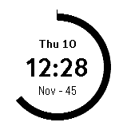
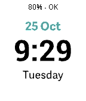
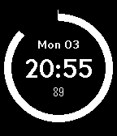

<!-- Generated by scripts/update_app_directory.py: do not edit by hand -->
[← All Pebble Developers](../developers.md)

# Maxwell Moseley

*4 watchfaces · Last updated 2026-10-11 · [About these lists](../about-app-lists.md)*

Links: [Pebble App Store](https://apps.repebble.com/apps/dev/maxwell-moseley_57afcb76bb85ed5f9b0003fc) · [GitHub (maxmoseley23)](https://github.com/maxmoseley23)

<button type="button" data-filter="all" aria-pressed="true">All 4</button><button type="button" data-filter="watchface" aria-pressed="false">Watchfaces 4</button><button type="button" data-filter="watchapp" aria-pressed="false" disabled>Apps 0</button>

<label class="dev-sort">Sort by <select><option value="updated">Recently updated</option><option value="released">Newest release</option><option value="title">A–Z</option></select></label>

<h2 class="app-name" id="app-582482ccb62cef78520000ad"><a href="https://apps.repebble.com/582482ccb62cef78520000ad">WeeklyRing</a> v1.0</h2>
<a class="app-source" href="https://github.com/maxmoseley23/DailyRing1/tree/weekly-ring" title="Source code" data-search-exclude>View source</a>

Watchface

Released 2016-11-10 Updated 2016-11-10

Runs on: Round 2, Time 2, Pebble 2 Duo, Pebble 2, Time Round, Time, Classic

See a full week pass with WeeklyRing! A full 7-day week is expressed as a circle starting on Sunday, while the hours, minutes, day of week, and date is expressed digitally. After 6PM, the dark…

<h2 class="app-name" id="app-581cd8db9cbbafc558000127"><a href="https://apps.repebble.com/581cd8db9cbbafc558000127">Basic 1</a> v1.3</h2>
<a class="app-source" href="https://github.com/maxmoseley23/Basic-1" title="Source code" data-search-exclude>View source</a>

Watchface

Released 2016-11-04 Updated 2016-11-06

Runs on: Round 2, Time 2, Pebble 2 Duo, Pebble 2, Time Round, Time, Classic

Back to basics. Battery friendly and lightweight. Just the time and date. Configure every colour. Set it to vibrate on top of the hour. Use military time instead of 12 hr. The choice is yours.

<h2 class="app-name" id="app-57f4043e3c754a8b010000d7"><a href="https://apps.repebble.com/57f4043e3c754a8b010000d7">Selina Int</a> v1.7</h2>
<a class="app-source" href="https://github.com/maxmoseley23/Selina1" title="Source code" data-search-exclude>View source</a>

Watchface

Released 2016-10-04 Updated 2016-10-26

Runs on: Round 2, Time 2, Pebble 2 Duo, Pebble 2, Time Round, Time, Classic

A watchface I made for my Sister. Bare essentials only - time, date, weekday, battery, and connection state. The Watch will vibrate upon disconnection and the OK status will disappear. Languages…

<h2 class="app-name" id="app-57afcbd0f01b53329a00037f"><a href="https://apps.repebble.com/57afcbd0f01b53329a00037f">DailyRing</a> v1.6</h2>
<a class="app-source" href="https://github.com/maxmoseley23/DailyRing1" title="Source code" data-search-exclude>View source</a>

Watchface

Released 2016-08-14 Updated 2016-10-04

Runs on: Round 2, Time 2, Pebble 2 Duo, Pebble 2, Time Round, Time, Classic

See a full day pass with DailyRing! A full 24-hour day is expressed as a circle, while the hours, minutes, day of week, and date is expressed digitally. After 6PM, the dark theme is enabled for…

