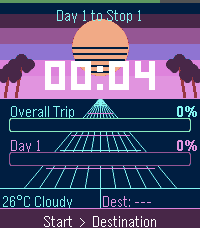

<!-- Generated by scripts/update_app_directory.py: do not edit by hand -->
[← All Pebble Developers](../developers.md)

# Maxwell Williams

*1 watchface · Last updated 2026-10-11 · [About these lists](../about-app-lists.md)*

Links: [Pebble App Store](https://apps.repebble.com/apps/dev/maxwell-williams_3133fe86efb8421bc2a5ef48) · [GitHub (Maxahoy)](https://github.com/Maxahoy)

<h2 class="app-name" id="app-e0674b14bb264d18a7d48374"><a href="https://apps.repebble.com/e0674b14bb264d18a7d48374">Journeys</a> v1.0.2</h2>
<a class="app-source" href="https://github.com/Maxahoy/pebble-journeys" title="Source code" data-search-exclude>View source</a>

Watchface

No licence Released 2026-06-09 Updated 2026-06-18

Runs on: Round 2, Time 2

A road trip companion watchface for Pebble Time 2. Tracks daily leg and overall trip progress automatically via GPS. Shows current and destination weather along the way. Shake your wrist to update…

