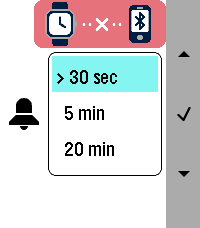

<!-- Generated by scripts/update_app_directory.py: do not edit by hand -->
[← All Pebble Developers](../developers.md)

# mc0e

*1 app · Last updated 2026-10-12 · [About these lists](../about-app-lists.md)*

Links: [Pebble App Store](https://apps.repebble.com/apps/dev/mc0e_ad6881d847504c23a06d9ecb) · [GitHub (mc0e)](https://github.com/mc0e)

<h2 class="app-name" id="app-61b1a39099e740eabd674088"><a href="https://apps.repebble.com/61b1a39099e740eabd674088">BT Guard</a> v1.1.0</h2>
<a class="app-source" href="https://github.com/mc0e/BT-Guard" title="Source code" data-search-exclude>View source</a>

App

Released 2026-09-27 Updated 2026-10-07

Runs on: Round 2, Time 2, Pebble 2 Duo

Keeps your phone on a tight leash. The app runs as a background app, monitoring the bluetooth connection to your phone. If the bluetooth connection is lost, it will buzz you, and keep on buzzing…

